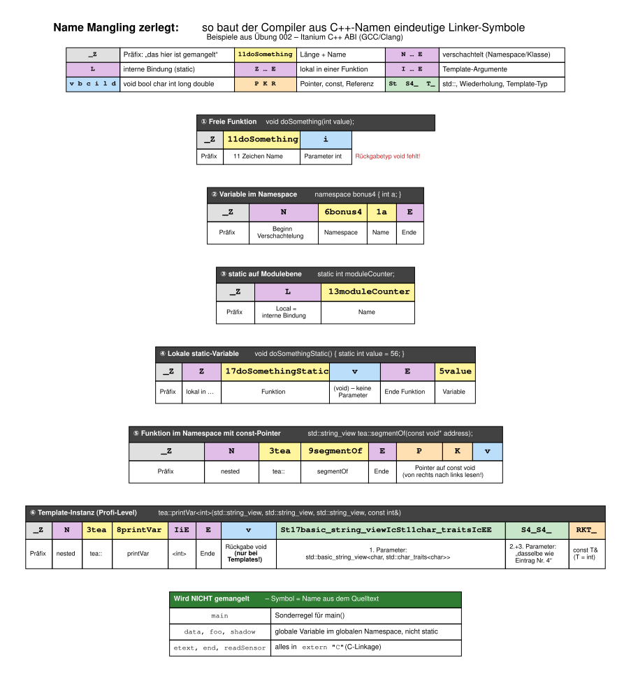
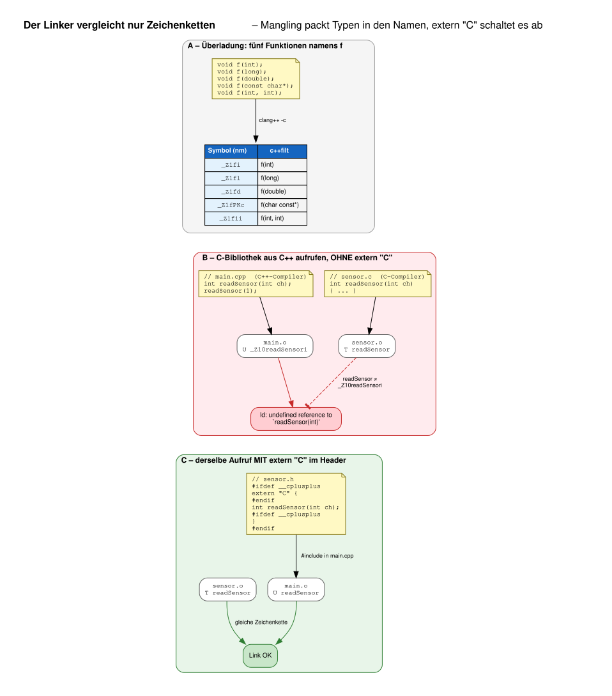
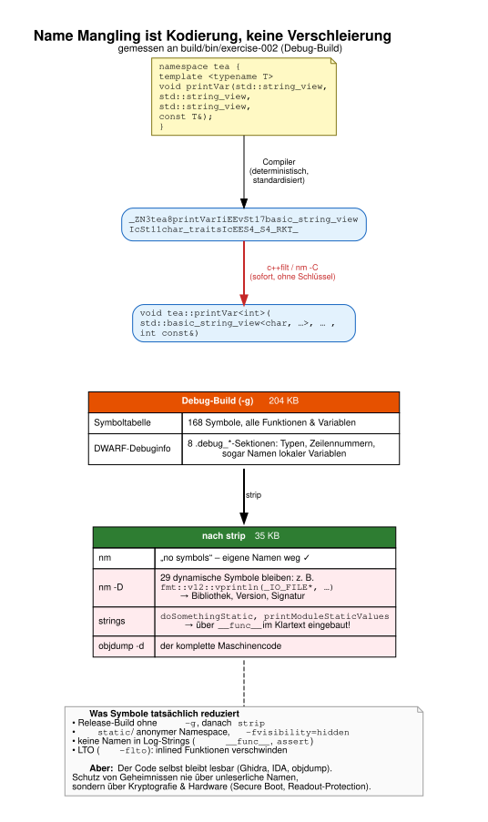

# Mikrocomputertechnik 3

Begleitprojekt für Mikrocomputertechnik 3 im Kurs tea24 an der DHBW Ravensburg Campus Friedrichshafen

**WICHTIG** Bitte verwenden sie zur Entwicklung die vorgefertigten Umgebungen.


## Synchronisation des eigenen Forks

Es wird davon ausgegangen, dass Sie einen Fork angelegt haben und von diesen geklont haben. Damit entspricht Ihr Fork der Bezeichnung ``origin``. Siehe hierzu auch die [Hinweise in der ersten Übungsaufgabe](exercise-001#upstream-hinzuf%C3%BCgen).

Um die aktuellen Änderungen in die lokale Kopie des ``tea24`` Repository zu übertragen sollten Sie zunächst ein ``git fetch`` durchführen

```sh
git fetch upstream
```

Nun checken wir die lokale Kopie des zu synchronisierenden Branches aus, in unserem Fall der ``main`` Branch. Dieser Schritt kann entfallen falls wir bereits schon auf dem ``main`` Branch sind. Das können Sie mit ``git branch -a`` prüfen.

```sh
git checkout main
```

Der Befehl ``git pull`` aktualisiert nun den lokalen Branch.

```sh
git pull upstream main
```

Sollte es hierbei zu einem Konflikt kommen haben Sie eventuell versehentlich lokale commits auf Ihrem ``main`` Branch durchgeführt. Das sollten Sie tunlichst vermeiden.

Im Erfolgsfall müssen jetzt nur noch die Daten in Ihren Fork gepusht werden:

```sh
git push origin main
```

## Übungsaufgaben

- [Übungsaufgabe Nr. 000](exercise-000/README.md)
- [Übungsaufgabe Nr. 001](exercise-001/README.md)
- [Übungsaufgabe Nr. 002](exercise-002/README.md): `static`, Sichtbarkeit und Speichersegmente
- [Übungsaufgabe Nr. 003](exercise-003/README.md): Statische Bibliothek, `configure_file`, C-API ([Lösung](exercise-003/SOLUTION.md))

## Hintergrundwissen

- [Name Mangling in C++](#name-mangling-in-c): warum `nm` Namen wie `_Z11doSomethingi` anzeigt

## Name Mangling in C++

Wer in den Übungen `nm` ohne `-C` aufruft, sieht Symbole wie `_ZZ17doSomethingStaticvE5value` statt
`doSomethingStatic()::value`. Dahinter steckt kein Fehler, sondern eine notwendige Technik: das **Name Mangling**
(auch *Name Decoration*).

### Das Problem: Der Linker kennt keine Typen

Der Linker arbeitet mit einer flachen Liste von Zeichenketten. Er weiß nichts über Namespaces, Klassen, Templates
oder Parametertypen. Für jedes `U` (undefined) sucht er ein Symbol mit **exakt derselben Zeichenkette**.

In C reicht das aus: Ein Funktionsname ist im ganzen Programm eindeutig. C++ erlaubt dagegen

* **Überladung**: `f(int)`, `f(long)` und `f(const char*)` sind drei verschiedene Funktionen,
* **Namespaces und Klassen**: `bonus4::a` und `a` sind verschiedene Variablen,
* **Templates**: `printVar<int>` und `printVar<bool>` sind verschiedene Funktionen.

Damit der Linker sie unterscheiden kann, kodiert der C++-Compiler die fehlenden Informationen **in den Symbolnamen**.

### Die Lösung: Typen in den Namen kodieren

GCC und Clang verwenden auf Linux (und auf ARM-/RISC-V-Mikrocontrollern) das Schema der
[Itanium C++ ABI](https://itanium-cxx-abi.github.io/cxx-abi/abi.html#mangling). Alle folgenden Beispiele stammen
direkt aus den Objektdateien von [Übung 002](exercise-002/SOLUTION.md):



Die wichtigsten Regeln:

| Kodierung | Bedeutung | Beispiel |
| --- | --- | --- |
| `_Z` | Beginn eines gemangelten Namens | `_Z…` |
| `<Länge><Name>` | Bezeichner mit vorangestellter Länge | `11doSomething` |
| `N … E` | verschachtelter Name (Namespace, Klasse) | `N3tea9segmentOfE` → `tea::segmentOf` |
| `L` | interne Bindung (`static`) | `_ZL13moduleCounter` |
| `Z … E` | lokale Entität innerhalb einer Funktion | `_ZZ17doSomethingStaticvE5value` |
| `I … E` | Template-Argumente | `IiE` → `<int>` |
| `v b c i l d` | `void bool char int long double` | `_Z1fd` → `f(double)` |
| `P` / `K` / `R` | Pointer / `const` / Referenz, von rechts nach links gelesen | `PKc` → `const char*` |
| `St` / `S4_` / `T_` | `std::` / Wiederholung eines früheren Teils / Template-Parameter | spart Platz bei langen Namen |

Zwei Details sind bemerkenswert:

* **Der Rückgabetyp fehlt** bei normalen Funktionen (`_Z11doSomethingi`). Deshalb kann man in C++ nicht allein über
  den Rückgabetyp überladen:
  `error: functions that differ only in their return type cannot be overloaded`.
  Nur bei Template-Instanzen ist er enthalten (das `v` in `printVar`).
* **Nicht alles wird gemangelt.** `main`, globale Variablen im globalen Namespace (`data`, `foo`, `shadow` aus
  `main.cpp`) und alles in `extern "C"` behalten ihren Namen aus dem Quelltext. Ein `static int shadow` erhält
  dagegen ein `L` und heißt in der Objektdatei `_ZL6shadow`.

### Gemangelte Namen lesen

```sh
nm    build/bin/exercise-002 | grep doSomething    # roh:            _Z11doSomethingi
nm -C build/bin/exercise-002 | grep doSomething    # demangled:      doSomething(int)
echo _ZN6bonus41aE | c++filt                       # einzelner Name: bonus4::a
objdump -d -C build/bin/exercise-002 | less        # Disassembly mit lesbaren Namen
```

Linker-Fehlermeldungen werden von `ld` automatisch demangled. Deshalb steht dort ``undefined reference to `f(int)'``
und nicht `_Z1fi`.

### C und C++ mischen: `extern "C"`

Name Mangling wird dann zum Problem, wenn C++ eine Funktion aufruft, die ein **C-Compiler** übersetzt hat, zum Beispiel
einen Hardware-Treiber, eine HAL oder eine Bibliothek wie FreeRTOS. Der C-Compiler mangelt nicht, der C++-Compiler
erwartet aber einen gemangelten Namen:



```text
/usr/bin/ld: main.o: in function `main':
main.cpp:(.text+0x15): undefined reference to `readSensor(int)'
```

Die Meldung ist irreführend, denn `readSensor` existiert ja in `sensor.o`, nur eben als `readSensor` und nicht als
`_Z10readSensori`. Die Lösung ist `extern "C"` im Header. Damit wird der Header für C **und** C++ nutzbar:

```c
#ifdef __cplusplus
extern "C" {
#endif

int readSensor(int channel);

#ifdef __cplusplus
}
#endif
```

Weitere Konsequenzen:

* Funktionen in `extern "C"` können **nicht überladen** werden (`error: conflicting types for 'log'`), weil es ohne
  Mangling nur einen Symbolnamen gibt.
* Die Linker-Symbole aus Übung 002 (`etext`, `end`, `__executable_start`) sind mit `extern "C"` deklariert.
  Bei Variablen im globalen Namespace wäre das streng genommen nicht nötig, denn sie werden ohnehin nicht gemangelt.
  Es dokumentiert aber, dass das Symbol von außerhalb von C++ kommt, und schützt vor Überraschungen: Dieselbe
  Deklaration in einem `namespace hw { … }` würde zu `_ZN2hw5etextE`, und der Linker fände sie nicht mehr.
* Das Mangling-Schema ist **compilerspezifisch**. MSVC macht aus `void doSomething(int)` beispielsweise
  `?doSomething@@YAXH@Z`. C++-Objektdateien verschiedener Compiler-Familien lassen sich deshalb nicht mischen,
  C-Schnittstellen dagegen schon. Auch die Standardbibliothek kodiert ABI-Versionen im Namen, etwa das
  `[abi:cxx11]` in `fmt::v12::vformat[abi:cxx11](…)`.

### Ist Name Mangling eine Verschleierung?

**Nein.** Diese Frage kam im Kurs auf, weil `_ZN3tea8printVarIiEE…` auf den ersten Blick unleserlich wirkt. Name
Mangling ist aber eine **Kodierung**, keine Verschlüsselung und keine Obfuscation:

* Es ist **deterministisch und öffentlich standardisiert**: Jeder GCC/Clang erzeugt für dieselbe Deklaration denselben Namen.
* Es ist **ohne Schlüssel umkehrbar**: `c++filt` stellt den vollständigen Namen samt aller Parametertypen wieder her.
* Es macht ein Programm sogar **gesprächiger als C**, denn dort steht nur `doSomething`, in C++ zusätzlich `(int)`.



Was nach `strip` im Debug-Build von Übung 002 noch übrig bleibt, wurde tatsächlich gemessen:

| Werkzeug | Debug-Build (204 KB) | nach `strip` (35 KB) |
| --- | --- | --- |
| `nm` | 168 Symbole | `no symbols` |
| `readelf -S` | 8 `.debug_*`-Sektionen (Typen, Zeilennummern, lokale Variablen) | keine |
| `nm -D` | dynamische Symbole | 29 bleiben, z. B. `fmt::v12::vprintln(_IO_FILE*, …)`: Bibliothek, Version und Signatur |
| `strings` | alles | `doSomethingStatic`, `printModuleStaticValues`, … über `__func__` im Klartext |
| `objdump -d` | Code mit Namen | Code ohne Namen, aber vollständig |

Wer Symbolinformationen wirklich reduzieren möchte, nimmt Release-Builds ohne `-g`, `strip`, `static` bzw. anonyme
Namespaces, `-fvisibility=hidden`, LTO (`-flto`) und verzichtet auf Funktionsnamen in Log-Ausgaben. Selbst dann
bleibt der Maschinencode mit Werkzeugen wie Ghidra lesbar. Echte Obfuscation-Tools machen das Analysieren nur
mühsamer, nicht unmöglich. **Geheimnisse (Schlüssel, Passwörter, Algorithmen) schützt man nie über unleserliche Namen**
(„Security by Obscurity“), sondern über Kryptografie und Hardware-Mechanismen wie Secure Boot oder die
Readout-Protection eines Mikrocontrollers.

### Grafiken neu erzeugen

Die Grafiken liegen als Graphviz-Quellen in [doc/](doc/) und werden so neu gerendert:

```sh
cmake --build build --target doc-diagrams
```

## Hilfreiche Links

- [Markdown Cheat Sheet](https://docs.github.com/en/get-started/writing-on-github)
- [Git Cheat Sheet](https://education.github.com/git-cheat-sheet-education.pdf)
