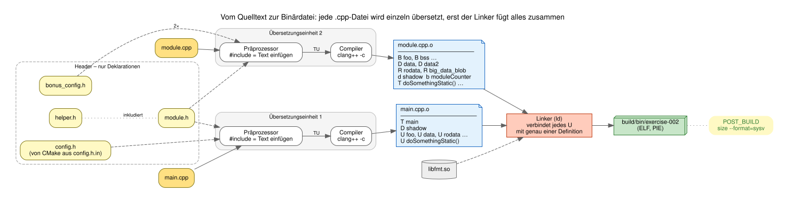
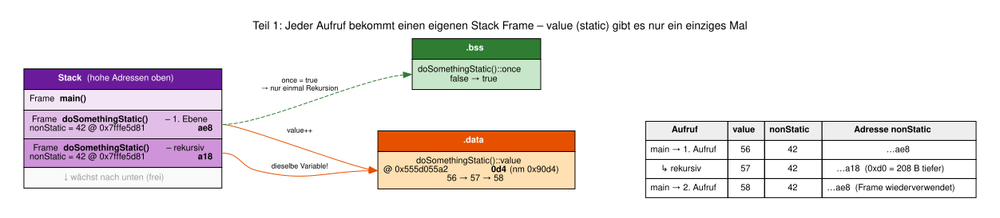
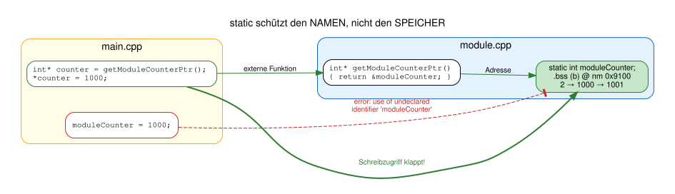
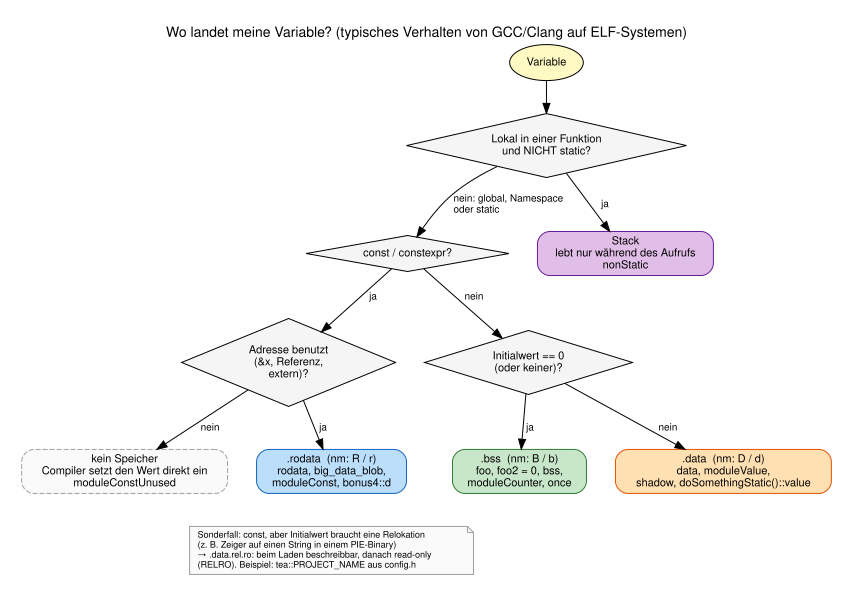
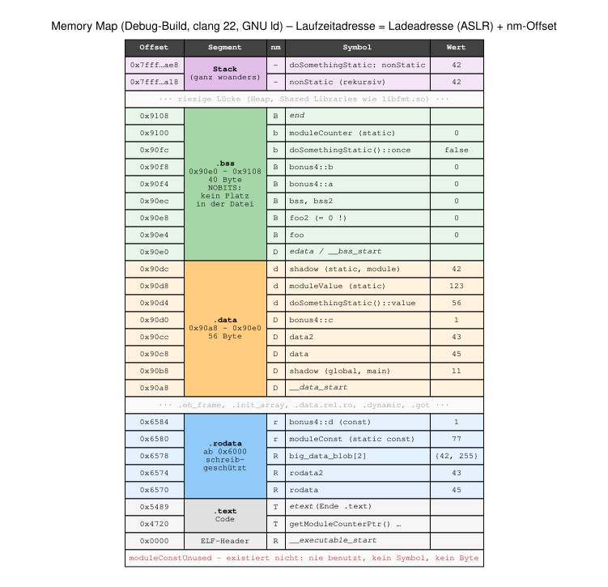
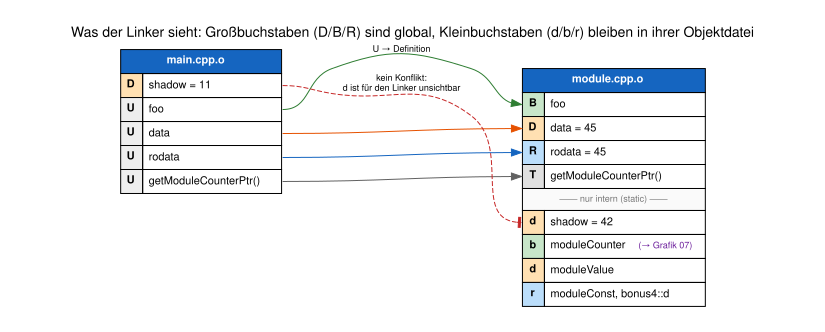
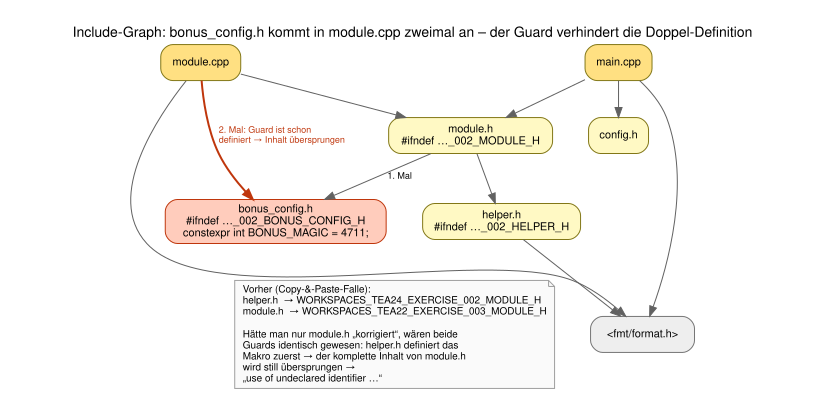

# Lösung Übung 002: `static`, Sichtbarkeit und Speichersegmente

Dieser Walkthrough geht die Aufgaben aus der [README.md](README.md) der Reihe nach durch.
Alle Zahlen stammen aus einem echten Lauf (Debug-Build, clang 22, GNU ld 2.44, x86-64 Linux).
Wer das Programm selbst startet, sieht **andere absolute Adressen** (ASLR, siehe unten), aber **dieselben Offsets**.

```sh
cmake --build build                                   # baut auch exercise-002
./build/bin/exercise-002                              # Walkthrough-Ausgabe
cmake --build build --target exercise-002-diagrams    # Grafiken neu erzeugen (braucht Graphviz)
```

### Inhalt

0. [Überblick: zwei Übersetzungseinheiten, ein Programm](#0-überblick-zwei-übersetzungseinheiten-ein-programm)
1. [Teil 1: `static` innerhalb einer Funktion](#teil-1-static-innerhalb-einer-funktion)
2. [Teil 2: `static` auf Modulebene](#teil-2-static-auf-modulebene)
3. [Teil 3: In welchem Segment landen die Variablen?](#teil-3-in-welchem-segment-landen-die-variablen)
4. [Bonus 1: Gleichnamige Variablen (`shadow`)](#bonus-1-gleichnamige-globale-variablen)
5. [Bonus 2: Include Guard absichtlich weglassen](#bonus-2-include-guard-absichtlich-weglassen)
6. [Bonus 3: Typische Anfängerfehler](#bonus-3-typische-anfängerfehler-rund-um-header--linker)
7. [Bonus 4: Null- und Nicht-Null-Initialisierung](#bonus-4-segmentanalyse-mit-null--und-nicht-null-initialisierung)
8. [Fazit (Abgabe)](#fazit-abgabe)

---

## 0. Überblick: zwei Übersetzungseinheiten, ein Programm



* `main.cpp` und `module.cpp` werden **unabhängig voneinander** kompiliert. Der Compiler sieht beim Übersetzen von
  `main.cpp` nur, was über `#include` hereinkommt, also Deklarationen wie `extern int foo;`.
* In der Objektdatei `main.cpp.o` steht deshalb für `foo` nur ein **U** (undefined): „Ich brauche `foo`, habe es aber nicht.“
* Erst der **Linker** sucht zu jedem `U` genau **eine** passende Definition (`B`, `D`, `R`, `T`) in einer anderen
  Objektdatei oder Bibliothek.

Das lässt sich direkt nachprüfen:

```sh
nm -C build/exercise-002/CMakeFiles/exercise-002.dir/main.cpp.o   | grep -E ' (U|D|T) '
nm -C build/exercise-002/CMakeFiles/exercise-002.dir/module.cpp.o | grep -E ' [bBdDrR] '
```

### Was das Programm ausgibt

Für den Walkthrough gibt jede Variable über den Helfer `tea::printVar()` (in [helper.h](helper.h)) einheitlich
Folgendes aus:

```text
[Funktion] Name = Wert  @ Laufzeitadresse  Segment (nm-Offset)  ✓/✗
```

* **Segment** wird *zur Laufzeit ermittelt*: Der GNU-Linker stellt die Symbole `etext`, `__data_start`, `edata` und
  `end` bereit, die die Grenzen von `.text`, `.data` und `.bss` markieren (`man 3 end`). Liegt die Adresse
  dazwischen, ist das Segment klar.
* **nm-Offset** = Laufzeitadresse − `__executable_start`. Das ist genau die Zahl, die `nm` in der Binärdatei anzeigt.
  So lässt sich die Programmausgabe 1:1 mit der Symboltabelle vergleichen.
* **✓** bedeutet, dass das erwartete Segment (im Quelltext angegeben) mit dem tatsächlichen übereinstimmt.

> **ASLR (Address Space Layout Randomization):** Linux lädt das Programm (ein *PIE*, Position Independent Executable)
> bei jedem Start an eine zufällige Basisadresse. Die absoluten Adressen ändern sich daher, die Abstände
> innerhalb des Programms nicht.

---

## Teil 1: `static` innerhalb einer Funktion

```cpp
void doSomethingStatic()
{
    static int value = 56;     // genau EINMAL initialisiert, lebt so lange wie das Programm -> .data
    int nonStatic = 42;        // bei JEDEM Aufruf neu angelegt und initialisiert -> Stack
    static bool once = false;  // = 0 -> .bss
    ...
    value = value + 1;
    nonStatic = nonStatic + 1;
    if (!once) { once = true; doSomethingStatic(); }   // einmal rekursiv
}
```

`main()` ruft die Funktion zweimal auf. Der erste Aufruf ruft sich dabei selbst noch einmal auf:

```text
── Teil 1: static innerhalb einer Funktion ──────────────────────────────────────────
[doSomethingStatic       ] value (static)           =    56  @ 0x555d055a20d4  .data   (nm 0x90d4)  ✓
[doSomethingStatic       ] nonStatic                =    42  @ 0x7fffe5d81ae8  stack              ✓
[doSomethingStatic       ] once (static)            =  true  @ 0x555d055a20fc  .bss    (nm 0x90fc)  ✓
[doSomethingStatic       ] -> rekursiver Aufruf, neuer Stack Frame
[doSomethingStatic       ] value (static)           =    57  @ 0x555d055a20d4  .data   (nm 0x90d4)  ✓
[doSomethingStatic       ] nonStatic                =    42  @ 0x7fffe5d81a18  stack              ✓
[doSomethingStatic       ] value (static)           =    58  @ 0x555d055a20d4  .data   (nm 0x90d4)  ✓
[doSomethingStatic       ] nonStatic                =    42  @ 0x7fffe5d81ae8  stack              ✓
```



### Beobachtungen

| Frage aus der README | Antwort |
| --- | --- |
| Bleibt die Adresse von `value` konstant? | **Ja**, immer `…0d4`. Es gibt genau **ein** Objekt, und das liegt in `.data`, nicht auf dem Stack. |
| Warum wird der Wert weiter erhöht? | Die Initialisierung `= 56` passiert nur **einmal** (der Wert steht schon in der Binärdatei). Danach wird nur noch inkrementiert, und der Wert bleibt über Aufrufe hinweg erhalten: 56 → 57 → 58. |
| Und die nicht-statische Variable? | `nonStatic` wird bei **jedem** Aufruf neu auf dem Stack angelegt und wieder mit 42 initialisiert. Das `+ 1` am Ende ist wirkungslos, weil die Variable mit dem Ende des Aufrufs verschwindet. |

* Durch den einmaligen **rekursiven** Aufruf sieht man zwei Frames gleichzeitig: Das `nonStatic` der zweiten Ebene
  liegt **0xd0 = 208 Byte tiefer** (`…ae8` → `…a18`), weil der Stack auf x86-64 **nach unten wächst**.
* Der zweite Aufruf aus `main()` landet wieder bei `…ae8`: Der Frame wird **wiederverwendet**, weil der Stack nach
  dem ersten Aufruf wieder abgebaut wurde.
* `once` ist ebenfalls `static`, startet aber mit `false` (= 0) und liegt deshalb in **`.bss`** statt in `.data`.

---

## Teil 2: `static` auf Modulebene

In [module.cpp](module.cpp) stehen die modul-lokalen Variablen. Sie werden in [module.h](module.h) bewusst **nicht**
deklariert:

```cpp
static int moduleCounter;                 // .bss
static int moduleValue = 123;             // .data
static const int moduleConst = 77;        // .rodata (Teil 3)
```

```text
── Teil 2: static auf Modulebene ────────────────────────────────────────────────────
[printModuleStaticValues ] moduleCounter (static)   =     1  @ 0x555d055a2100  .bss    (nm 0x9100)  ✓
[printModuleStaticValues ] moduleValue (static)     =   123  @ 0x555d055a20d8  .data   (nm 0x90d8)  ✓
[printModuleStaticValues ] data                     =    45  @ 0x555d055a20c8  .data   (nm 0x90c8)  ✓
[printModuleStaticValues ] moduleCounter (static)   =     2  @ 0x555d055a2100  .bss    (nm 0x9100)  ✓
[printModuleStaticValues ] moduleValue (static)     =   165  @ 0x555d055a20d8  .data   (nm 0x90d8)  ✓
[printModuleStaticValues ] data                     =    45  @ 0x555d055a20c8  .data   (nm 0x90c8)  ✓
[main                    ] *getModuleCounterPtr() = 1000  -> Name privat, Speicher nicht!
[printModuleStaticValues ] moduleCounter (static)   =  1001  @ 0x555d055a2100  .bss    (nm 0x9100)  ✓
[printModuleStaticValues ] moduleValue (static)     =   207  @ 0x555d055a20d8  .data   (nm 0x90d8)  ✓
[printModuleStaticValues ] data                     =    45  @ 0x555d055a20c8  .data   (nm 0x90c8)  ✓
```

### Ist die Variable wirklich nur im Modul sichtbar?

**Versuch 1:** In `module.h` zusätzlich `extern int moduleCounter;` deklarieren. Der Compiler meldet:

```text
module.cpp:21:12: error: static declaration of 'moduleCounter' follows non-static declaration
   21 | static int moduleCounter;
      |            ^
module.h:17:12: note: previous declaration is here
   17 | extern int moduleCounter;
      |            ^
```

Eine Variable kann nicht gleichzeitig externe (`extern`) und interne (`static`) Bindung haben. Das ist keine
Eigenheit eines bestimmten oder „modernen“ Compilers, sondern eine **Sprachregel** von C und C++.

**Versuch 2:** In `main.cpp` direkt `moduleCounter = 1000;` schreiben. Dann gilt:
`error: use of undeclared identifier 'moduleCounter'`. Der Name ist in `main.cpp` schlicht unbekannt.

**Versuch 3 (der Linker):** Selbst eine eigene `extern int moduleCounter;`-Deklaration in `main.cpp` würde beim
**Linken** mit `undefined reference to 'moduleCounter'` scheitern. Der Grund: In `module.cpp.o` steht das Symbol
als **`b`** (Kleinbuchstabe = lokal), und lokale Symbole bietet die Objektdatei dem Linker gar nicht erst an.

### Frage: Was passiert bei einem Pointer auf eine modulstatische Variable?



Das funktioniert problemlos:

```cpp
// module.cpp
int* getModuleCounterPtr() { return &moduleCounter; }

// main.cpp
int* counter = getModuleCounterPtr();
*counter = 1000;               // moduleCounter ist danach 1000, beim nächsten Aufruf 1001
```

**`static` schränkt die Sichtbarkeit des *Namens* ein (Linkage), nicht den Zugriff auf den *Speicher*.**
Das Objekt liegt ganz normal in `.bss` und lebt bis zum Programmende. Wer die Adresse kennt, kann es lesen und
schreiben. Das ist kein Sicherheitsmechanismus, sondern ein Werkzeug zur **Kapselung**. Wenn das Modul die Adresse
herausgibt, hat es diese Entscheidung selbst getroffen. (Wer nur Lesezugriff erlauben möchte, gibt einen
`const int*` zurück.)

---

## Teil 3: In welchem Segment landen die Variablen?

### Symbole mit `nm`

```sh
nm -SC ./build/bin/exercise-002
```

Das `-C` (demangle) wird benötigt, um das **Name Mangling** von C++ aufzulösen. Eine ausführliche Erklärung samt
Grafik steht in der [Projekt-README](../README.md#name-mangling-in-c):

| ohne `-C` | mit `-C` |
| --- | --- |
| `000000000000502c 0000000000000004 d _ZZ17doSomethingStaticvE5value` | `000000000000502c 0000000000000004 d doSomethingStatic()::value` |

(Werte aus dem ursprünglichen Build. Da danach Variablen hinzugekommen sind, liegt `value` jetzt bei `0x90d4`.)

Auszug aus dem aktuellen Build, sortiert nach Adresse:

```text
0000000000006570 0000000000000004 R rodata
0000000000006574 0000000000000004 R rodata2
0000000000006578 0000000000000008 R big_data_blob
0000000000006580 0000000000000004 r moduleConst
0000000000006584 0000000000000004 r bonus4::d
00000000000090b8 0000000000000004 D shadow                      <- aus main.cpp
00000000000090c8 0000000000000004 D data
00000000000090cc 0000000000000004 D data2
00000000000090d0 0000000000000004 D bonus4::c
00000000000090d4 0000000000000004 d doSomethingStatic()::value
00000000000090d8 0000000000000004 d moduleValue
00000000000090dc 0000000000000004 d shadow                      <- aus module.cpp (static)
00000000000090e4 0000000000000004 B foo
00000000000090e8 0000000000000004 B foo2
00000000000090ec 0000000000000004 B bss
00000000000090f0 0000000000000004 B bss2
00000000000090f4 0000000000000004 B bonus4::a
00000000000090f8 0000000000000004 B bonus4::b
00000000000090fc 0000000000000001 b doSomethingStatic()::once
0000000000009100 0000000000000004 b moduleCounter
```

Häufige Typbuchstaben in der `nm`-Ausgabe:

| Buchstabe | Bedeutung |
| --- | --- |
| `B` / `b` | **BSS**: uninitialisierte oder null-initialisierte Daten |
| `D` / `d` | initialisierte, beschreibbare Daten, typischerweise **`.data`** |
| `R` / `r` | schreibgeschützte Daten, typischerweise **`.rodata`** |
| `T` / `t` | Programmcode, typischerweise **`.text`** |
| `U` | undefiniertes Symbol: wird von einer anderen Objektdatei oder Bibliothek bereitgestellt |
| `W` / `w` | schwaches Symbol (z. B. Template-Instanzen, Inline-Funktionen) |

**Großbuchstabe = global (externe Bindung), Kleinbuchstabe = lokal (interne Bindung, also `static`).**
Hier sieht man das Schlüsselwort `static` direkt in der Binärdatei wieder.

> **Hinweis:** Die Buchstaben sind eine hilfreiche Zuordnung, aber nicht für jede ELF-Sektion eine vollständige oder
> eindeutige Beschreibung. Die genaue Sektion zeigt `readelf -sW` (Spalte `Ndx`) zusammen mit `readelf -SW`.

### Die vier Variablen aus der Aufgabe

| Variable | Segment | nm | Begründung |
| --- | --- | --- | --- |
| `static int moduleCounter;` | `.bss` | `b` | kein Initialisierer → 0 |
| `static int moduleValue = 123;` | `.data` | `d` | Wert ≠ 0 muss in der Datei gespeichert werden |
| `static const int moduleConst = 77;` | `.rodata` | `r` | `const` und die Adresse wird benutzt (siehe unten) |
| `static int value = 56;` in `doSomethingStatic()` | `.data` | `d` | Lebensdauer wie eine globale Variable, Wert ≠ 0 |



**Wann landet `const` in `.rodata`?** Nur dann, wenn der Compiler tatsächlich Speicher braucht, also wenn die Adresse
benutzt wird (`&x`, Bindung an eine Referenz wie bei `printVar`, oder `extern`-Zugriff aus einer anderen
Übersetzungseinheit). Zum Vergleich enthält `module.cpp` eine zweite Konstante:

```cpp
[[maybe_unused]] static const int moduleConstUnused = 78;
```

Diese Konstante wird nirgends benutzt. `nm -C build/bin/exercise-002 | grep moduleConstUnused` liefert **nichts**, es
gibt weder ein Symbol noch ein Byte dafür. Konstanten, deren Adresse nie gebraucht wird, setzt der Compiler direkt als
Zahl in den Maschinencode ein.

### Segmentgrößen mit `size`

Das CMake-`POST_BUILD`-Kommando zeigt nach jedem Build:

```text
section                size    addr
.text                 13038    8592
.rodata                1420   24576
.data.rel.ro             16   36232
.data                    56   37032
.bss                     40   37088
```

Das klassische Berkeley-Format fasst die Sektionen gröber zusammen:

```text
$ size build/bin/exercise-002
   text    data     bss     dec     hex filename
  21977     872      40   22889    5969 build/bin/exercise-002
```

> Achtung: In diesem Format zählt `text` **alles Schreibgeschützte** (also auch `.rodata`, `.eh_frame` und Header) und
> `data` alles Beschreibbare mit Inhalt (auch `.got`, `.dynamic`, `.data.rel.ro`). Deshalb sind die Zahlen größer als
> die einzelnen Sektionen. Auf einem Mikrocontroller gilt: `text + data` belegen **Flash**, `data + bss` belegen **RAM**.

### Die vollständige Memory Map

Die Laufzeit-Ausgabe aus Teil 3 bestätigt jede Zeile mit ✓. Zusätzlich gibt das Programm die Grenzen aus, die der
Linker gesetzt hat:

```text
Segmentgrenzen laut Linker (nm-Offset):
  .text   endet bei   0x5489  (etext)
  .data   beginnt bei 0x90a8  (__data_start)
  .bss    beginnt bei 0x90e0  (edata)
  .bss    endet bei   0x9108  (end)
```



Gut zu erkennen:

* `foo2 = 0` liegt **neben `foo`** in `.bss`, nicht in `.data` (Details in Bonus 4).
* `.bss` hat in `readelf -SW` den Typ **`NOBITS`**: Es belegt in der Datei keinen Platz. Der Loader (bzw. auf dem
  Mikrocontroller der Startup-Code) füllt den Bereich beim Start mit Nullen.
* `rodata` & Co. haben in `main.cpp` **dieselbe Adresse** wie in `module.cpp`. Es gibt nur ein Objekt, beide
  Übersetzungseinheiten greifen über den Linker darauf zu.

---

## Bonus 1: Gleichnamige „globale“ Variablen

```cpp
// main.cpp                       // module.cpp
int shadow = 11;                  static int shadow = 42;
```

```text
── Bonus 1: gleichnamige Variablen in main.cpp und module.cpp ───────────────────────
[main                    ] shadow (global, main)    =    11  @ 0x555d055a20b8  .data   (nm 0x90b8)  ✓
[printTheModuleShadow    ] shadow (static, module)  =    42  @ 0x555d055a20dc  .data   (nm 0x90dc)  ✓
```



* **Welche Funktion greift auf welche Variable zu?** Jede Funktion sieht das `shadow` **ihrer eigenen**
  Übersetzungseinheit: `main()` sieht 11, `printTheModuleShadow()` sieht 42.
* **Warum sind die Adressen unterschiedlich?** Es sind **zwei völlig getrennte Objekte**. `nm` zeigt beide:
  `D shadow` (global) und `d shadow` (lokal).
* **Welche Rolle spielt `static`?** Ohne `static` in `module.cpp` gäbe es zwei globale Definitionen mit demselben Namen,
  und der Linker würde abbrechen:

  ```text
  /usr/bin/ld: module.cpp.o:(.data+0x8): multiple definition of `shadow'; main.cpp.o:(.data+0x0): first defined here
  ```

  Mit `static` erreicht das `shadow` aus `module.cpp` den Linker gar nicht erst, also gibt es keinen Konflikt.

Das ist der Unterschied zwischen **Dateisichtbarkeit (internal linkage)** und **Programmsichtbarkeit (external linkage)**.

---

## Bonus 2: Include Guard absichtlich weglassen

Umgesetzt mit [bonus_config.h](bonus_config.h): Der Header wird in `module.h` **und** direkt in `module.cpp`
eingebunden.



Mit auskommentiertem Guard meldet clang:

```text
In file included from module.cpp:7:
./bonus_config.h:19:15: error: redefinition of 'BONUS_MAGIC'
   19 | constexpr int BONUS_MAGIC = 4711;
      |               ^
./module.h:5:10: note: './bonus_config.h' included multiple times, additional include site here
module.cpp:7:10: note: './bonus_config.h' included multiple times, additional include site here
./bonus_config.h:19:15: note: unguarded header; consider using #ifdef guards or #pragma once
```

Mit Guard wird der Inhalt beim zweiten Mal übersprungen, und der Build läuft wieder.

> **Falle in der Aufgabenstellung:** Enthält der Header **nur einen Funktionsprototyp** (`void bonus();`), dann gibt es
> **keinen** Fehler. Eine Deklaration darf beliebig oft wiederholt werden. Erst eine **Definition**
> (Variable, `constexpr`-Konstante, `struct`/`class`, Inline-Funktion) macht den fehlenden Guard sichtbar.

**Was macht der Präprozessor?** `#include` ist reines Text-Kopieren, bevor der eigentliche Compiler loslegt.
Den Zwischenstand kann man sich ansehen:

```sh
clang++ -E -I build/exercise-002/include exercise-002/module.cpp | grep -n BONUS_MAGIC
```

### Bonus 2b: Kollidierende Guard-Namen (echter Copy-&-Paste-Fehler aus dieser Übung)

Ursprünglich hatten die Header diese Guards:

```cpp
// helper.h
#ifndef WORKSPACES_TEA24_EXERCISE_002_MODULE_H   // <- Name passt nicht zur Datei
// module.h
#ifndef WORKSPACES_TEA22_EXERCISE_003_MODULE_H   // <- falscher Kurs, falsche Übung
```

Das funktionierte nur zufällig. Hätte man nur `module.h` „korrigiert“, hätten beide Header **denselben** Guard gehabt.
Weil `module.h` zuerst `helper.h` inkludiert, ist das Makro bereits definiert, und der **gesamte Inhalt von
`module.h` wird still übersprungen**:

```text
main.cpp: error: use of undeclared identifier 'doSomethingStatic'
```

(Nachgestellt mit den Original-Headern aus git, nur der Guard in `module.h` „korrigiert“.)

Welcher Header dabei verschwindet, hängt von der **Reihenfolge** ab. Im neuen `module.h` stehen die `#include`s
*innerhalb* des Guards. Dort würde stattdessen `helper.h` übersprungen, und die Meldung lautete
`use of undeclared identifier '__executable_start'`.

Dieser Fehler ist besonders gemein, weil die Meldung nicht auf den Header zeigt. Abhilfe: Guard-Namen konsequent aus
dem Dateinamen ableiten (jetzt `…_002_MODULE_H`, `…_002_HELPER_H`, `…_002_BONUS_CONFIG_H`) oder `#pragma once` verwenden.

---

## Bonus 3: Typische Anfängerfehler rund um Header & Linker

Alle Meldungen wurden mit clang 22 / GNU ld reproduziert.

| # | Fehler | Wer meckert? | Meldung | Korrektur |
| --- | --- | --- | --- | --- |
| 1 | `int x = 5;` im Header, von zwei `.cpp` inkludiert | **Linker** | ``multiple definition of `x'`` | Header: `extern int x;`, genau eine `.cpp`: `int x = 5;` (oder C++17: `inline int x = 5;`) |
| 2 | `extern int y;` ohne Definition | **Linker** | ``undefined reference to `y'`` | In genau einer `.cpp` `int y;` definieren |
| 3 | `.h`: `void f(int);`, `.cpp`: `void f(long) {}` | **Linker** | ``undefined reference to `f(int)'`` | Signaturen angleichen |
| 4 | `void show(int* p);` mit `show(&limit)` und `const int limit` | **Compiler** | `candidate function not viable: 1st argument ('const int *') would lose const qualifier` | Interface `const`-korrekt machen: `void show(const int* p);` |

Zu Fehler 1: Der Include Guard hilft hier **nicht**. Er wirkt nur innerhalb **einer** Übersetzungseinheit, der Konflikt
entsteht aber erst beim Zusammenlinken **mehrerer** Übersetzungseinheiten.

Zu Fehler 3: Das ist kein Compilerfehler. Durch Überladung ist `f(long)` eine **andere** Funktion, die einfach
zusätzlich definiert wird. Dank Name Mangling (`_Z1fi` vs. `_Z1fl`) merkt das erst der Linker. In C (ohne Mangling)
würde es sogar fehlerfrei linken und zur Laufzeit falsch laufen.

---

## Bonus 4: Segmentanalyse mit Null- und Nicht-Null-Initialisierung

```cpp
namespace bonus4 {
int a;            // .bss
int b = 0;        // .bss
int c = 1;        // .data
const int d = 1;  // .rodata
}
```

```text
── Bonus 4: Null- und Nicht-Null-Initialisierung ────────────────────────────────────
[printBonusSegments      ] bonus4::a                =     0  @ 0x555d055a20f4  .bss    (nm 0x90f4)  ✓
[printBonusSegments      ] bonus4::b (= 0)          =     0  @ 0x555d055a20f8  .bss    (nm 0x90f8)  ✓
[printBonusSegments      ] bonus4::c (= 1)          =     1  @ 0x555d055a20d0  .data   (nm 0x90d0)  ✓
[printBonusSegments      ] bonus4::d (const)        =     1  @ 0x555d0559f584  .rodata (nm 0x6584)  ✓
```

* **Warum landen `a` und `b` in `.bss`?** Globale Variablen ohne Initialisierer sind laut Standard **null-initialisiert**.
  Für `= 0` erkennt der Compiler, dass das Ergebnis dasselbe ist. Statt Nullen in der Datei zu speichern, merkt er sich
  nur die **Größe**, und beim Programmstart wird `.bss` en bloc genullt. Das spart Platz in der Datei bzw. im Flash.
  (Mit `-fno-zero-initialized-in-bss` könnte man `b` in `.data` erzwingen.)
* **Warum liegt `c` in `.data`?** Der Wert `1` muss irgendwo herkommen, also steht er in der Datei und wird beim Start
  ins RAM geladen (auf Mikrocontrollern vom Startup-Code aus dem Flash kopiert).
* **Wann erscheint `d` in `.rodata`?** Wenn seine Adresse gebraucht wird. Hier bindet `printVar(…, const T& var)` eine
  Referenz an `d`, also braucht der Compiler ein echtes Objekt. Wird nur der Wert benutzt, verschwindet `d` komplett
  (vgl. `moduleConstUnused` in Teil 3).
* **Bonus-Erkenntnis:** `nm` zeigt `r bonus4::d` mit **kleinem** `r`. In C++ hat eine `const`-Variable auf
  Namespace-Ebene automatisch **interne Bindung**, als stünde `static` davor. Deshalb steht in `module.h` vor
  `rodata` ein `extern`: Nur so wird `const int rodata = 45;` in `module.cpp` zu einem globalen `R` und kann aus
  `main.cpp` benutzt werden. (In C ist das anders, dort ist `const` standardmäßig extern.)

---

## Fazit (Abgabe)

### 1. Unterschied zwischen `static` in einer Funktion und auf Modulebene

Das Schlüsselwort ist dasselbe, die Wirkung aber unterschiedlich:

| | `static` in einer Funktion | `static` auf Modulebene |
| --- | --- | --- |
| Ändert … | die **Lebensdauer** (automatisch → statisch) | die **Bindung** (extern → intern) |
| Sichtbarkeit | unverändert: nur innerhalb der Funktion | nur innerhalb der Übersetzungseinheit |
| Lebensdauer | jetzt: gesamte Programmlaufzeit | war schon vorher die gesamte Laufzeit |
| Initialisierung | genau einmal | genau einmal (vor `main`) |
| Speicher | `.data` / `.bss` statt Stack | `.data` / `.bss` (unverändert) |

### 2. Segmente der Beispielvariablen

* **`.bss`**: `foo`, `foo2 = 0`, `bss`, `bss2`, `moduleCounter`, `doSomethingStatic()::once`, `bonus4::a`, `bonus4::b`
* **`.data`**: `data`, `data2`, `moduleValue`, `doSomethingStatic()::value`, beide `shadow`, `bonus4::c`
* **`.rodata`**: `rodata`, `rodata2`, `big_data_blob`, `moduleConst`, `bonus4::d`
* **Stack**: `nonStatic`
* **nirgends**: `moduleConstUnused` (wegoptimiert)

### 3. Warum `static` für Kapselung nützlich ist

* Hilfsvariablen und -funktionen eines Moduls bleiben **privat**: keine Namenskollisionen mit anderen Modulen
  (siehe `shadow`), keine versehentlichen Zugriffe von außen.
* Die **Schnittstelle** (`module.h`) bleibt klein. Was nicht im Header steht und `static` ist, kann man ändern, ohne
  dass andere Module neu angepasst werden müssen.
* Der Compiler weiß, dass niemand sonst auf die Variable zugreift, und kann daher besser optimieren
  (z. B. `moduleConstUnused` ganz entfernen).
* **Aber:** `static` schützt nur den Namen. Über eine herausgegebene Adresse ist der Speicher weiterhin erreichbar
  (siehe `getModuleCounterPtr()`).

> In modernem C++ erreicht man dasselbe auch mit einem **anonymen Namespace** (`namespace { int moduleCounter; }`).
> Das funktioniert zusätzlich für Typen (`struct`, `class`), auf die `static` nicht angewendet werden kann.
