# Lösung Übung 003: Statische Bibliothek für Projekt-Versionierung

Dieser Walkthrough geht die Aufgaben aus der [README.md](README.md) der Reihe nach durch.
Alle Ausgaben, Größen und Fehlermeldungen stammen aus echten Läufen (Debug-Build, clang 22, GNU ld 2.44, CMake + Ninja).

```sh
cmake --build build                                   # baut Bibliothek, Übung, Bonus-Programme und Tests
./build/bin/exercise-003                              # Walkthrough-Ausgabe (statisch gelinkt)
./build/bin/exercise-003-shared                       # dasselbe, dynamisch gelinkt (Bonus 4)
./build/bin/exercise-003-cli --help                   # zweiter Nutzer der Bibliothek (Bonus 2)
./build/bin/exercise-003-c                            # C-Programm über die C-API (Bonus 3)
ctest --test-dir build -R version                     # Unit-Tests (Bonus 1)
cmake --build build --target exercise-003-diagrams    # Grafiken neu erzeugen (braucht Graphviz)
```

## Inhalt

1. [Teil 1: Projektstruktur](#teil-1-projektstruktur)
2. [Teil 2: API der Bibliothek](#teil-2-api-der-bibliothek)
3. [Teil 3: Version per `*.h.in` erzeugen](#teil-3-version-per-hin-erzeugen)
4. [Teil 4: Bibliothek in `exercise-003` verwenden](#teil-4-bibliothek-in-exercise-003-verwenden)
5. [Teil 5: Verifizieren](#teil-5-verifizieren)
6. [Fazit (Abgabe)](#fazit-abgabe)
7. [Bonus 1: `isAtLeast()` + Unit-Tests](#bonus-1-isatleast--unit-tests)
8. [Bonus 2: Zweiter Nutzer](#bonus-2-zweiter-nutzer-der-bibliothek)
9. [Bonus 3: C-API und Name Mangling](#bonus-3-c-api-und-name-mangling)
10. [Bonus 4: Statisch vs. dynamisch](#bonus-4-statische-vs-dynamische-bibliothek)
11. [Bonus 5: Typische Fehler](#bonus-5-typische-anfängerfehler)
12. [Bonus 6: Klausurmodus](#bonus-6-klausurmodus)
13. [Stolperfallen, die in dieser Übung wirklich passiert sind](#stolperfallen-die-in-dieser-übung-wirklich-passiert-sind)

---

## Teil 1: Projektstruktur

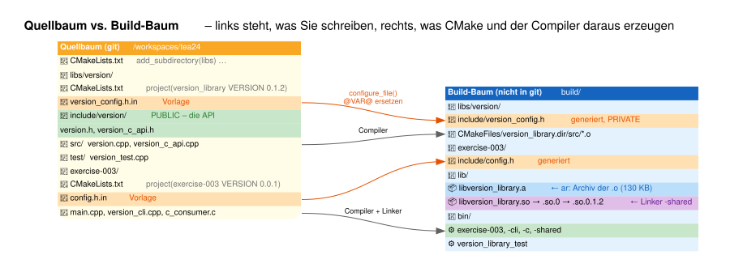

Die Struktur entspricht der Vorgabe. Hinzugekommen sind die Dateien für die Bonusaufgaben:

```text
libs/version/
├── CMakeLists.txt
├── version_config.h.in              Vorlage für den generierten Header
├── include/version/
│   ├── version.h                    C++-API          (PUBLIC)
│   └── version_c_api.h              C-API, Bonus 3   (PUBLIC)
├── src/
│   ├── version.cpp
│   └── version_c_api.cpp            Bonus 3
└── test/
    └── version_test.cpp             Catch2, Bonus 1

exercise-003/
├── CMakeLists.txt
├── config.h.in
├── main.cpp                         wird zweimal gebaut: statisch + dynamisch
├── version_cli.cpp                  Bonus 2
├── c_consumer.c                     Bonus 3 (echtes C!)
└── doc/                             Graphviz-Quellen + SVGs
```

Im Root-[CMakeLists.txt](../CMakeLists.txt) steht `add_subdirectory(libs)` (das wiederum
`add_subdirectory(version)` aufruft) jetzt **vor** den Übungen. CMake würde es auch umgekehrt akzeptieren, weil
Target-Namen erst in der Generate-Phase aufgelöst werden. So liest es sich aber in der Reihenfolge, in der die
Abhängigkeiten entstehen.

**Warum `include/version/version.h` und nicht einfach `include/version.h`?** Der zusätzliche Ordner wird Teil des
Include-Namens: `#include "version/version.h"`. Das verhindert Kollisionen, denn eine Datei namens `version.h` gibt
es in vielen Bibliotheken, `version/version.h` dagegen nur hier.

---

## Teil 2: API der Bibliothek

[version.h](../libs/version/include/version/version.h):

```cpp
namespace tea::version
{
const char* projectName();
int major();
int minor();
int patch();
std::string fullVersion();           // "version_library-0.1.2"
const char* configureDate();         // zusätzlich: wann lief configure_file()?
bool isAtLeast(int major, int minor, int patch);   // Bonus 1
}
```

Gegenüber der ersten Version wurden einige Dinge geändert:

* **Namespace `tea::version`**: Freie Funktionen namens `major()` oder `patch()` im globalen Namespace kollidieren
  leicht mit anderen Bibliotheken. Im Symbol sieht man den Namespace wieder (siehe
  [Name Mangling](../README.md#name-mangling-in-c)): `_ZN3tea7version5majorEv`.
* **`fullVersion()` liefert `name-major.minor.patch`**, so wie in der Aufgabe gefordert (`tea24-0.0.1`). Vorher kam nur
  `0.1.2` zurück.
* **Include Guard und `#include <string>`** stehen jetzt *innerhalb* des Guards.
* **Kein `#include "version_config.h"` im öffentlichen Header.** Das ist Absicht und wird in Teil 3 erklärt.

> ⚠️ Die Namen `major()` und `minor()` aus der Aufgabenstellung haben eine echte Falle, siehe
> [Stolperfalle 1](#stolperfalle-1-glibc-makros-major-und-minor).

---

## Teil 3: Version per `*.h.in` erzeugen

[version_config.h.in](../libs/version/version_config.h.in):

```cpp
#ifndef TEA24_VERSION_CONFIG_H
#define TEA24_VERSION_CONFIG_H

namespace tea::version::config
{
constexpr auto NAME{"@PROJECT_NAME@"};
constexpr auto VERSION{"@PROJECT_VERSION@"};
constexpr int MAJOR{@PROJECT_VERSION_MAJOR@};
constexpr int MINOR{@PROJECT_VERSION_MINOR@};
constexpr int PATCH{@PROJECT_VERSION_PATCH@};
constexpr auto CONFIGURE_DATE{"@BUILD_DATE@"};
}

#endif
```

Statt `#define VERSION_LIB_VERSION_MAJOR 0` (Vorschlag der README) werden `constexpr`-Konstanten in einem Namespace
verwendet. Sie haben einen Typ, sind im Debugger sichtbar und können nicht mit Makros anderer Bibliotheken
kollidieren. Beides ist korrekt, `constexpr` ist der modernere Weg.

Aus der Vorlage erzeugt CMake beim **Configure** den Header `build/libs/version/include/version_config.h`:

```cpp
namespace tea::version::config
{
constexpr auto NAME{"version_library"};
constexpr auto VERSION{"0.1.2"};
constexpr int MAJOR{0};
...
```

In [libs/version/CMakeLists.txt](../libs/version/CMakeLists.txt) sind die drei geforderten Schritte umgesetzt:

```cmake
project (version_library VERSION 0.1.2 LANGUAGES CXX)       # liefert PROJECT_VERSION_MAJOR …

configure_file(                                              # 1. Header erzeugen
    "${CMAKE_CURRENT_SOURCE_DIR}/version_config.h.in"
    "${CMAKE_CURRENT_BINARY_DIR}/include/version_config.h"
    @ONLY)                                                   # nur @VAR@ ersetzen, ${VAR} in Ruhe lassen

add_library(version_library STATIC ${VERSION_LIBRARY_SOURCES})   # 3. statische Bibliothek
add_library(tea24::version ALIAS version_library)

target_include_directories(version_library                   # 2. Include-Pfade
    PUBLIC  ${CMAKE_CURRENT_SOURCE_DIR}/include              #    API -> für alle Nutzer
    PRIVATE ${CMAKE_CURRENT_BINARY_DIR}/include              #    generierter Header -> nur intern
)
target_link_libraries(version_library PRIVATE fmt::fmt)
```

### Wann läuft `configure_file()`?

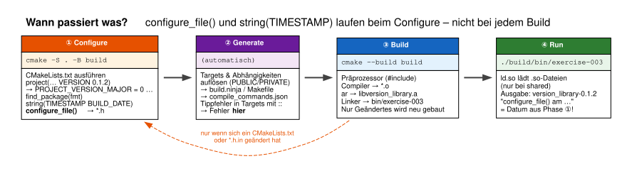

`configure_file()` und `string(TIMESTAMP …)` werden **beim Configure** ausgeführt, nicht bei jedem Build. Das wurde
nachgemessen:

| Aktion | Uhrzeit | Ausgabe „configure_file() am“ |
| --- | --- | --- |
| `main.cpp` und `version.cpp` geändert, `cmake --build` | 13:00:30 | `12:59:40` (alter Wert!) |
| `CMakeLists.txt` geändert, `cmake --build` → `Re-running CMake...` | 13:00:31 | `13:00:31` |

Deshalb heißt die Funktion `configureDate()` und nicht `buildDate()`. Der Wert ist das Datum des letzten
CMake-Laufs. Der Nebeneffekt: Bei jedem Configure ändert sich der generierte Header, und alles, was ihn einbindet,
wird neu kompiliert. Zeitstempel in Headern machen außerdem Builds **nicht reproduzierbar** (zwei Builds desselben
Quelltexts ergeben unterschiedliche Binärdateien). In professionellen Projekten nimmt man stattdessen z. B. den
git-Commit-Hash oder `SOURCE_DATE_EPOCH`.

### Warum ist `version_config.h` PRIVATE?

Der generierte Header wird nur in `version.cpp` eingebunden, nicht in `version.h`. Nutzer der Bibliothek sehen die
Version ausschließlich über Funktionen. Das hat zwei Vorteile:

1. **Kapselung**: Die Konstanten sind ein Implementierungsdetail und können umbenannt werden, ohne dass Nutzer
   etwas merken.
2. **Weniger Neukompilieren**: Ändert sich die Version, muss nur `version.cpp` neu übersetzt werden, nicht jede
   Datei, die `version.h` einbindet.

---

## Teil 4: Bibliothek in `exercise-003` verwenden

[exercise-003/CMakeLists.txt](CMakeLists.txt):

```cmake
add_executable(${PROJECT_NAME} main.cpp)
target_include_directories(${PROJECT_NAME} PRIVATE "${CMAKE_CURRENT_BINARY_DIR}/include")   # config.h
target_link_libraries(${PROJECT_NAME} PRIVATE tea24::version fmt::fmt)
```

Es ist kein `add_subdirectory(../libs/version)` nötig, und auch kein `target_include_directories` für
`libs/version/include`. Den Include-Pfad liefert `tea24::version` über `PUBLIC` automatisch mit.

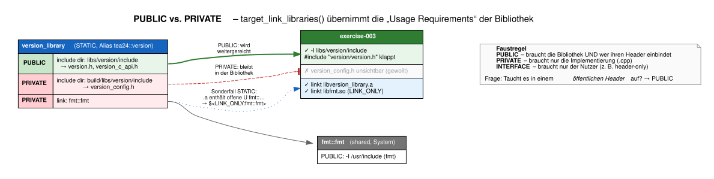

CMake selbst kann den Abhängigkeitsgraphen als Graphviz-Datei exportieren. Die folgende Grafik ist **nicht
von Hand gezeichnet**, sondern stammt direkt aus `cmake --graphviz=exercise-003/doc/04_cmake_targets.dot build`:

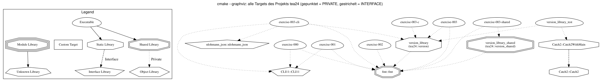

Man sieht: `exercise-003`, `-c`, `-cli` und `version_library_test` hängen alle an **derselben**
`version_library`. Genau das ist der Sinn einer Bibliothek.

### Ausgabe

```text
── Teil 4: Versionsinfos aus der Bibliothek ──────────────────────────────────────────────────
Project: version_library
Version: 0.1.2
Full:    version_library-0.1.2

── Wessen Version ist das? Drei CMake-Projekte, zwei Konfig-Header ───────────────────────────
  Quelle                                     Name             Version  configure_file() am
  Root-CMakeLists.txt (CMAKE_PROJECT_NAME)   tea24            –        –
  exercise-003/config.h                      exercise-003     0.0.1    2026-11-08T13:00:31
  version_config.h (über die Lib-API)        version_library  0.1.2    2026-11-08T13:00:31
```

Die README erwartet `Project: tea24`. Hier steht `version_library`, weil die Bibliothek in ihrem
`CMakeLists.txt` ein **eigenes `project()`** aufruft:

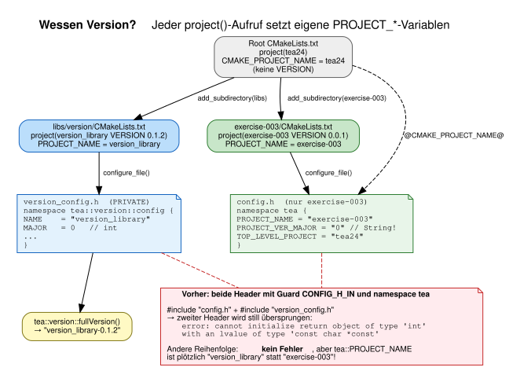

* `CMAKE_PROJECT_NAME` ist immer das **oberste** Projekt (`tea24`).
* `PROJECT_NAME` / `PROJECT_VERSION` beziehen sich auf das **zuletzt aufgerufene** `project()` im aktuellen
  Verzeichnis oder darüber.

Wer wirklich die Version des Gesamtprojekts ausgeben möchte, gibt dem Root-Projekt eine Version
(`project(tea24 VERSION 0.0.1)`) und verwendet in der Bibliothek `@CMAKE_PROJECT_NAME@` und
`@CMAKE_PROJECT_VERSION@`. Beides ist legitim, man muss sich nur bewusst entscheiden: **Versioniert die Bibliothek
sich selbst oder das Projekt?**

---

## Teil 5: Verifizieren

**Liegt die Bibliothek unter `build/lib`?**

```text
$ ls -l build/lib
130820  libversion_library.a
    23  libversion_library.so -> libversion_library.so.0
    27  libversion_library.so.0 -> libversion_library.so.0.1.2
 92608  libversion_library.so.0.1.2
```

Die README spricht von `libversion.a`. Der Dateiname ergibt sich aus dem Target-Namen: `version_library`
→ `lib` + `version_library` + `.a`. Das Präfix `lib` und die Endung ergänzt CMake je nach Plattform.

**Was steckt drin?** Eine statische Bibliothek ist nur ein **Archiv** von Objektdateien:

```text
$ ar t build/lib/libversion_library.a
version.cpp.o
version_c_api.cpp.o

$ nm -C build/lib/libversion_library.a
version.cpp.o:
0000000000000040 T tea::version::fullVersion[abi:cxx11]()
0000000000000010 T tea::version::major()
...
                 U fmt::v12::vformat[abi:cxx11](...)
```

**Wird korrekt gelinkt?** Ja, und das lässt sich sogar zur Laufzeit beweisen (siehe Bonus 4): `dladdr()` meldet,
dass `tea::version::fullVersion()` im Programm `exercise-003` selbst liegt. Der Code wurde also beim Linken aus dem
Archiv ins Programm kopiert.

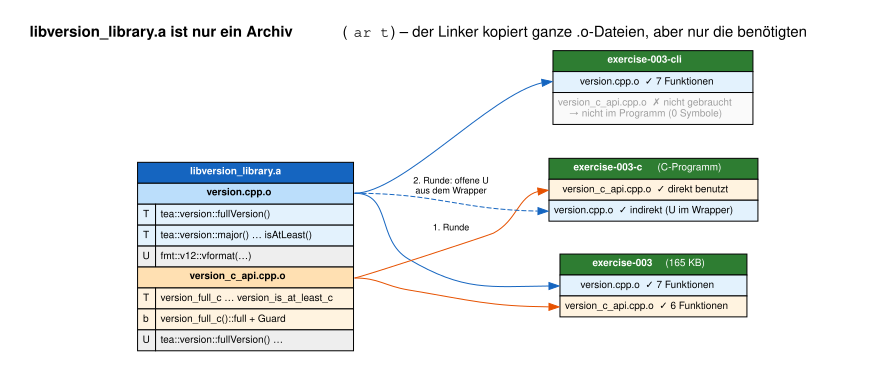

Bemerkenswert: Der Linker übernimmt **ganze `.o`-Dateien, aber nur die benötigten**. `exercise-003-cli` nutzt nur
die C++-API und enthält deshalb keine einzige C-API-Funktion:

```text
Programm                C++-API-Symbole   C-API-Symbole
exercise-003                  7                 6
exercise-003-cli              7                 0      <- version_c_api.cpp.o nicht gelinkt
exercise-003-c                7                 6      <- C++-API indirekt über den Wrapper
exercise-003-shared           0                 0      <- alles in der .so
```

Deshalb verteilt man Code in Bibliotheken für Mikrocontroller oft auf viele kleine `.cpp`-Dateien: Was nicht
benutzt wird, belegt keinen Flash. (Feiner geht es noch mit `-ffunction-sections` + `-Wl,--gc-sections`, dann
entfernt der Linker sogar einzelne Funktionen.)

---

## Fazit (Abgabe)

### 1. Unterschied zwischen Bibliotheks-Header und generiertem Konfig-Header

| | `version/version.h` | `version_config.h` |
| --- | --- | --- |
| Wer schreibt ihn? | Entwickler, liegt in git | CMake beim Configure, liegt im Build-Ordner |
| Inhalt | Deklarationen der API (Funktionen) | konkrete Werte (Name, Version, Datum) |
| Sichtbarkeit | **PUBLIC**: Nutzer binden ihn ein | **PRIVATE**: nur `version.cpp` |
| Ändert sich, wenn … | sich die API ändert (selten) | sich Version oder `CMakeLists.txt` ändern |
| Folge einer Änderung | alle Nutzer neu kompilieren | nur `version.cpp` neu kompilieren |

### 2. Warum ist `configure_file(...)` für Versionsdaten nützlich?

* **Single Source of Truth**: Die Version steht genau einmal, in `project(… VERSION 0.1.2)`. Code, Paketname,
  `SOVERSION` der Shared Library und Dokumentation leiten sich daraus ab. Es gibt keine zweite Stelle, die man
  vergessen kann.
* **Werte aus dem Build-System in den Code**: Alles, was CMake weiß (Version, Compiler, Optionen, Datum, git-Hash),
  wird zur Compile-Zeit als typisierte Konstante verfügbar.
* **Generiert statt gepflegt**: Der Header liegt im Build-Ordner, nicht in git. Es gibt keine Merge-Konflikte und
  keine veralteten Werte.

### 3. Wie spielen `PUBLIC` Include-Pfade und Link-Abhängigkeiten zusammen?

`target_link_libraries(exercise-003 PRIVATE tea24::version)` bedeutet mehr als nur „linke die `.a`-Datei“: Das
Programm **übernimmt alle PUBLIC- und INTERFACE-Eigenschaften** der Bibliothek, also Include-Pfade, Compile-Definitionen
und weitere Link-Abhängigkeiten. Include-Pfad und Link gehören damit untrennbar zusammen. Wer linkt, bekommt
den Header, und wer den Header braucht, muss linken. Bonus 5 zeigt die Kehrseite: Ohne `target_link_libraries`
fehlt nicht zuerst das Symbol, sondern schon **der Header**.

Ein Sonderfall: `fmt` ist bei der Bibliothek `PRIVATE`. Weil eine statische Bibliothek aber nur ein Archiv mit offenen
Referenzen (`U fmt::v12::vformat`) ist, reicht CMake `fmt` trotzdem als `$<LINK_ONLY:fmt::fmt>` an die Nutzer weiter:
**Link ja, Include-Pfad nein.**

---

## Bonus 1: `isAtLeast()` + Unit-Tests

```cpp
bool isAtLeast(int major, int minor, int patch)
{
    return std::tie(config::MAJOR, config::MINOR, config::PATCH) >= std::tie(major, minor, patch);
}
```

`std::tie` baut Tupel aus Referenzen, und Tupel werden **lexikografisch** verglichen, also genau wie Versionsnummern:
erst `major`, bei Gleichstand `minor`, dann `patch`. So entfällt die fehleranfällige `if`-Kaskade.

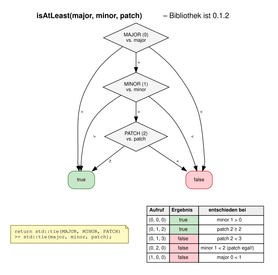

```text
── Bonus 1: isAtLeast() – lexikografischer Vergleich ───────────────────────────────────────
  isAtLeast(0, 0, 0)  ->  true    (Bibliothek ist 0.1.2)
  isAtLeast(0, 1, 1)  ->  true    (Bibliothek ist 0.1.2)
  isAtLeast(0, 1, 2)  ->  true    (Bibliothek ist 0.1.2)
  isAtLeast(0, 1, 3)  ->  false   (Bibliothek ist 0.1.2)
  isAtLeast(0, 2, 0)  ->  false   (Bibliothek ist 0.1.2)
  isAtLeast(1, 0, 0)  ->  false   (Bibliothek ist 0.1.2)
```

Die geforderten „mehreren Vergleichsfälle“ sind als **Catch2-Unit-Tests** umgesetzt:
[libs/version/test/version_test.cpp](../libs/version/test/version_test.cpp). Sie hängen an der Bibliothek, nicht an
der Übung, und sie verwenden **keine festen Versionsnummern**, sondern rechnen relativ zu `major()`, `minor()` und
`patch()`. Wird die Version erhöht, bleiben die Tests grün:

```text
$ ctest --test-dir build -R version
100% tests passed out of 1

$ ./build/bin/version_library_test
All tests passed (21 assertions in 4 test cases)
```

**„API stabil halten“** heißt dabei: `isAtLeast()` wurde nur **hinzugefügt**. Bestehende Funktionen haben ihre
Signatur behalten. Alter Code, der die Bibliothek nutzt, kompiliert und linkt weiterhin. Was eine Änderung anrichten
würde, zeigt `nm` (getestet):

| Änderung | Symbol vorher | Symbol nachher | Folge für bereits gebaute Programme (Bonus 4) |
| --- | --- | --- | --- |
| `isAtLeast(int, int, int)` → `(unsigned, unsigned, unsigned)` | `_ZN3tea7version9isAtLeastEiii` | `…isAtLeastEjjj` | Start bricht ab: `undefined symbol` – **laut** |
| `int major()` → `unsigned major()` | `_ZN3tea7version5majorEv` | **identisch** | startet, interpretiert den Wert evtl. falsch – **still** |

Der Rückgabetyp ist nicht Teil des gemangelten Namens (siehe [Name Mangling](../README.md#name-mangling-in-c)).
Deshalb ist eine Änderung des Rückgabetyps besonders gefährlich: Sie bricht die ABI, ohne dass der Loader es merkt.

---

## Bonus 2: Zweiter Nutzer der Bibliothek

[version_cli.cpp](version_cli.cpp) ist ein kleines Kommandozeilenwerkzeug. Es nutzt **CLI11** und **nlohmann_json**,
die im Projekt ohnehin schon per `find_package` gesucht wurden:

```text
$ ./build/bin/exercise-003-cli
version_library-0.1.2
$ ./build/bin/exercise-003-cli --part minor
1
$ ./build/bin/exercise-003-cli --json
{
  "full": "version_library-0.1.2",
  "major": 0,
  "minor": 1,
  "name": "version_library",
  "patch": 2
}
$ ./build/bin/exercise-003-cli --at-least 0.2.0; echo "Exit-Code: $?"
version_library-0.1.2 < 0.2.0
Exit-Code: 1
```

Über den Exit-Code von `--at-least` lässt sich die Versionsprüfung direkt in Shell-Skripten verwenden
(`exercise-003-cli --at-least 0.1.0 && echo ok`). Beide Programme liefern konsistente Werte, weil keines davon
Versionscode enthält. Alles kommt aus `tea24::version`.

---

## Bonus 3: C-API und Name Mangling

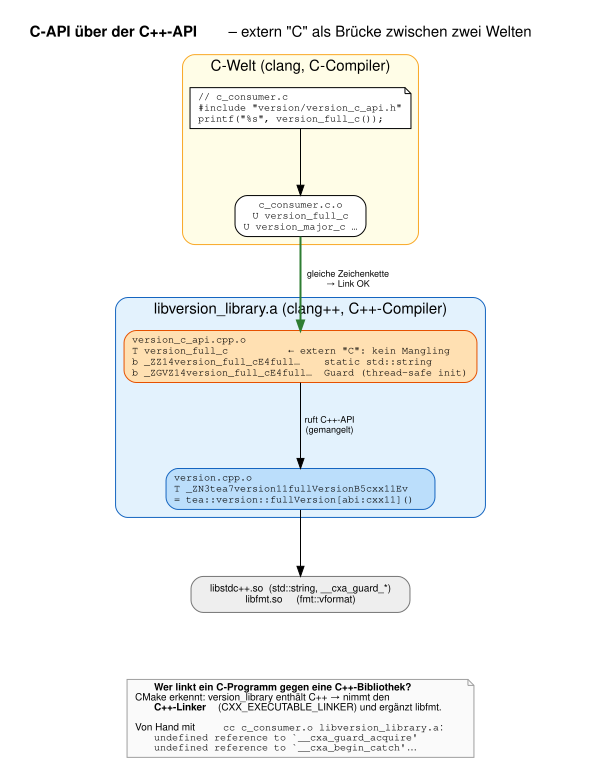

[version_c_api.h](../libs/version/include/version/version_c_api.h) folgt dem Muster aus der README und kommt ohne
alles aus, was C nicht kennt (Namespaces, `std::string`, `bool`, Überladung). [c_consumer.c](c_consumer.c) ist ein
**echtes C-Programm**, das mit dem C-Compiler übersetzt wird:

```text
$ ./build/bin/exercise-003-c
[C] Name:    version_library
[C] Version: 0.1.2
[C] Full:    version_library-0.1.2
[C] >= 0.1.0? ja
[C] >= 1.0.0? nein
```

### Die Fragen aus der README

```text
$ nm build/lib/libversion_library.a | grep ' T '
0000000000000040 T _ZN3tea7version11fullVersionB5cxx11Ev     <- C++
0000000000000010 T _ZN3tea7version5majorEv
...
0000000000000000 T version_full_c                             <- extern "C"
00000000000000a0 T version_major_c
```

| Frage | Antwort |
| --- | --- |
| Wie heißt die C++-Funktion als Symbol? | `_ZN3tea7version11fullVersionB5cxx11Ev`: Namespace `tea::version`, Name, ABI-Tag `cxx11` (wegen `std::string`), Parameter `v` (void) |
| Wie heißt die Funktion mit `extern "C"`? | `version_full_c`, genau wie im Quelltext |
| Welche Symbole sind aus C nutzbar? | Nur die `extern "C"`-Symbole. Ein C-Compiler erzeugt Referenzen ohne Mangling und kann `_ZN3tea…` nicht ausdrücken. Außerdem könnte C mit `std::string` als Rückgabetyp nichts anfangen. |

Mehr zum Aufbau gemangelter Namen steht in der [Projekt-README](../README.md#name-mangling-in-c).

### Zwei Details, die die README nicht erwähnt

**1. Lebensdauer des zurückgegebenen Strings.** Die Vorlage aus der README nutzt `static std::string buffer`. Die
Lösung macht daraus eine **funktionslokale `static const`-Variable**, initialisiert beim ersten Aufruf:

```cpp
const char* version_full_c(void)
{
    static const std::string full = tea::version::fullVersion();
    return full.c_str();
}
```

Das ist das Wissen aus Übung 002 in Aktion. Die Variable liegt in `.bss`, lebt bis Programmende, und der Zeiger
bleibt gültig. Weil die Initialisierung erst zur Laufzeit passiert, legt der Compiler eine **Guard-Variable** an, die
sie seit C++11 auch bei mehreren Threads genau einmal ausführt:

```text
$ nm build/lib/libversion_library.a | grep version_full_cE4full
0000000000000020 b _ZGVZ14version_full_cE4fullB5cxx11      <- GV = Guard Variable
0000000000000000 b _ZZ14version_full_cE4fullB5cxx11        <- die Variable selbst
```

Mit einer normalen lokalen Variable (`std::string full = …; return full.c_str();`) hätte man einen Dangling Pointer
auf freigegebenen Speicher, genau wie bei `doReturnAPtr()` aus Übung 002.

**2. Ein C-Programm gegen eine C++-Bibliothek linken.** Die Bibliothek braucht `libstdc++` (für `std::string` und
die Guard-Funktionen) und `libfmt`. Mit dem C-Linker von Hand gelinkt, scheitert es:

```text
$ cc c_consumer.c.o build/lib/libversion_library.a
undefined reference to `__cxa_begin_catch'
undefined reference to `__cxa_guard_abort'
undefined reference to `__cxa_guard_acquire'
undefined reference to `__cxa_guard_release'
...
```

CMake erledigt das automatisch: Es weiß, dass `version_library` C++ enthält, linkt `exercise-003-c` mit dem
**C++-Linker** (`CXX_EXECUTABLE_LINKER` in `build.ninja`) und hängt `libfmt` an.

---

## Bonus 4: Statische vs. dynamische Bibliothek

Aus denselben Quellen entsteht zusätzlich `version_library_shared` (`SHARED`). Dieselbe `main.cpp` wird zweimal
gelinkt: als `exercise-003` (statisch) und als `exercise-003-shared` (dynamisch). Mit `dladdr()` fragt das Programm
den Loader, **aus welcher Datei** eine Funktion stammt:

```text
── Bonus 4: Wo liegt der Code? (dieses Programm ist statisch gelinkt) ────────────────────────
  main()                             @ 0x561bd5e3e240  aus ./build/bin/exercise-003
  tea::version::fullVersion()        @ 0x561bd5e400c0  aus ./build/bin/exercise-003
  version_full_c()                   @ 0x561bd5e40af0  aus ./build/bin/exercise-003
  std::printf() (libc)               @ 0x7fc11e0ef880  aus /lib/x86_64-linux-gnu/libc.so.6

── Bonus 4: Wo liegt der Code? (dieses Programm ist dynamisch gelinkt) ───────────────────────
  main()                             @ 0x559637aed280  aus ./build/bin/exercise-003-shared
  tea::version::fullVersion()        @ 0x7f72857e0550  aus /workspaces/tea24/build/lib/libversion_library.so.0
  version_full_c()                   @ 0x7f72857e1000  aus /workspaces/tea24/build/lib/libversion_library.so.0
  std::printf() (libc)               @ 0x7f728528d880  aus /lib/x86_64-linux-gnu/libc.so.6
```

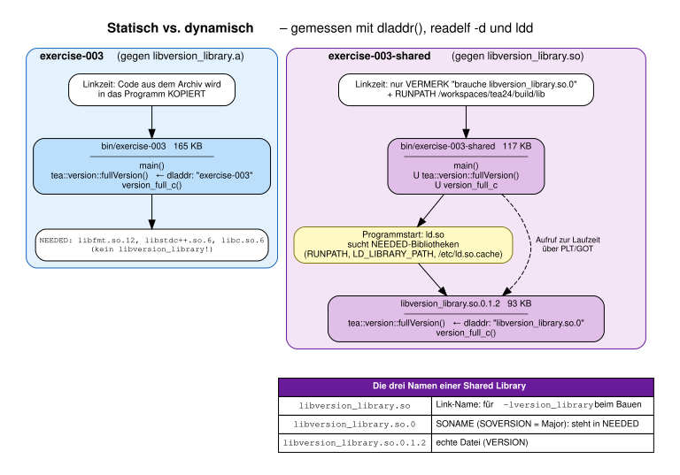

### Vergleich

| | statisch (`.a`) | dynamisch (`.so`) |
| --- | --- | --- |
| Artefakt | `libversion_library.a` (130 KB, inkl. Debug-Info) | `libversion_library.so.0.1.2` (93 KB) + 2 Symlinks |
| Programmgröße | `exercise-003`: 165 KB | `exercise-003-shared`: 117 KB |
| `readelf -d` NEEDED | `libfmt`, `libstdc++`, `libc` | **zusätzlich** `libversion_library.so.0` |
| Wann wird der Code eingebunden? | **Linkzeit**: in das Programm kopiert | **Laufzeit**: `ld.so` lädt die `.so` beim Start |
| Wie wird sie gefunden? | gar nicht nötig | `RUNPATH` (`/workspaces/tea24/build/lib`, von CMake gesetzt), `LD_LIBRARY_PATH`, `/etc/ld.so.cache` |
| Update der Bibliothek | alle Programme neu linken | `.so` austauschen, Programme bleiben (solange die ABI passt) |
| Mehrere Programme | jedes hat eine eigene Kopie | eine Kopie im RAM, von allen geteilt |
| Deployment | eine Datei, läuft überall | Programm + passende `.so` müssen zusammen ausgeliefert werden |

**Die drei Dateinamen** kommen aus `VERSION` und `SOVERSION`:

* `libversion_library.so` ist der Link-Name. Ihn sucht der Linker bei `-lversion_library` (nur beim Entwickeln nötig).
* `libversion_library.so.0` ist der **SONAME** (`SOVERSION` = Major-Version). Dieser Name steht im Programm unter
  `NEEDED`. Eine neue Version `0.2.0` mit gleichem SONAME kann die alte ersetzen. Bei einer inkompatiblen Änderung
  erhöht man die Major-Version, und der SONAME wechselt auf `.so.1`. Alte Programme laden dann weiter `.so.0`.
* `libversion_library.so.0.1.2` ist die eigentliche Datei.

Die Programmgröße im Debug-Build täuscht übrigens: Der Unterschied von 48 KB besteht fast nur aus Debug-Infos. Nach
`strip` sieht es umgekehrt aus:

| | Debug-Build | nach `strip` |
| --- | --- | --- |
| `exercise-003` (statisch) | 165 KB | **27 KB** |
| `exercise-003-shared` (dynamisch) | 117 KB | **31 KB** |

Das dynamisch gelinkte Programm ist sogar **größer**, denn es braucht für jede Bibliotheksfunktion Einträge in der
dynamischen Symboltabelle sowie PLT/GOT-Einträge. Der eigentliche Code der Bibliothek ist mit rund 5 KB `.text`
(`size` auf die `.o`-Dateien, davon das meiste inline erzeugter `fmt`-Code) klein. Bei so kleinen Bibliotheken spart
dynamisches Linken keinen Platz, der Vorteil liegt bei Updates und beim Teilen zwischen vielen Programmen.

---

## Bonus 5: Typische Anfängerfehler

Alle Fehler wurden in einer Kopie des Projekts erzeugt. Die Meldungen sind original (Pfade gekürzt).

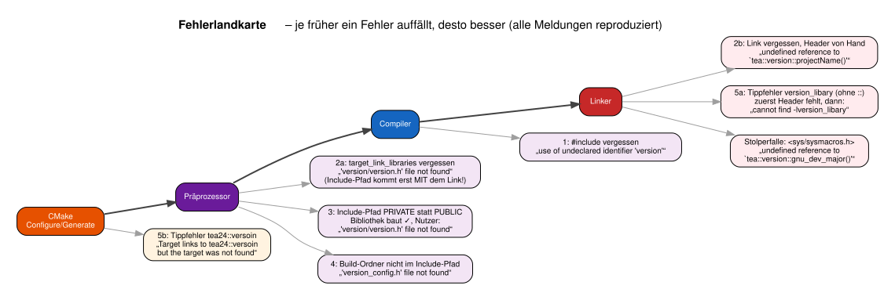

| # | Fehler | Meldung | Ursache | Fix |
| --- | --- | --- | --- | --- |
| 1 | `#include "version/version.h"` vergessen | `error: expected namespace name`<br>`error: use of undeclared identifier 'version'` | Der Compiler kennt die Deklarationen nicht | Header einbinden |
| 2a | `target_link_libraries(… tea24::version)` vergessen | `fatal error: 'version/version.h' file not found` | Ohne Link gibt es auch den **PUBLIC-Include-Pfad** nicht | `target_link_libraries` ergänzen |
| 2b | wie 2a, aber Include-Pfad von Hand gesetzt | ``undefined reference to `tea::version::projectName()'`` | Header gefunden, aber die Implementierung fehlt beim Linken | dito. Include-Pfade von Hand sind ein Warnsignal |
| 3 | Include-Pfad der Bibliothek `PRIVATE` statt `PUBLIC` | Bibliothek baut ✓, Nutzer: `fatal error: 'version/version.h' file not found` | `PRIVATE` gilt nur für die Bibliothek selbst | API-Header → `PUBLIC` |
| 4 | Build-Ordner fehlt im Include-Pfad | `fatal error: 'version_config.h' file not found` | `configure_file` schreibt nach `CMAKE_CURRENT_BINARY_DIR`, gesucht wird im Quellbaum | `${CMAKE_CURRENT_BINARY_DIR}/include` aufnehmen |
| 5a | Tippfehler `version_libary` | erst `'version/version.h' file not found`, mit Header dann `ld: cannot find -lversion_libary` | Unbekannte Namen hält CMake für eine **Systembibliothek** → `-lversion_libary` | ALIAS mit `::` verwenden |
| 5b | Tippfehler `tea24::versoin` | `CMake Error … Target "exercise-003" links to: tea24::versoin but the target was not found.` | Namen mit `::` müssen Targets sein | sofortige, klare Meldung ✓ |

Zwei Lehren daraus:

* **Fehler 2a ist überraschend.** Man erwartet einen Linkerfehler, bekommt aber einen Präprozessorfehler. In
  modernem CMake hängen Include-Pfad und Link zusammen (siehe Fazit 3).
* **Fehler 5 ist der Grund für das ALIAS-Target `tea24::version`.** Ohne `::` wird ein Tippfehler still zu einer
  Linker-Option und fällt erst spät und schwer verständlich auf. Mit `::` meldet CMake ihn sofort beim Configure.

---

## Bonus 6: Klausurmodus

#### 1. Unterschied statische und dynamische Bibliothek?
Eine statische Bibliothek ist ein Archiv von Objektdateien. Der Linker **kopiert** die benötigten Teile beim Bauen
ins Programm. Eine dynamische Bibliothek ist eine eigenständige ladbare Datei. Das Programm enthält nur einen
**Verweis** (`NEEDED`), und der Loader bindet sie **beim Programmstart** ein. Details siehe Tabelle in Bonus 4.

#### 2. Dateiendungen

| | statisch | dynamisch |
| --- | --- | --- |
| Linux/Unix | `lib<name>.a` | `lib<name>.so` (+ `.so.<major>` und `.so.<x.y.z>`) |
| macOS | `lib<name>.a` | `lib<name>.dylib` |
| Windows (MSVC) | `<name>.lib` | `<name>.dll` + Import-Bibliothek `<name>.lib` |

Achtung bei Windows: `.lib` kann zwei Dinge bedeuten, nämlich eine echte statische Bibliothek oder eine
Import-Bibliothek, die nur auf die `.dll` verweist.

**3. Welche Form im Mikrocontroller-Umfeld?** Fast immer **statisch**:

* Es gibt meist kein Betriebssystem und damit keinen dynamischen Loader (`ld.so`).
* Das Programm wird als **ein** Image in den Flash geschrieben. Es gibt kein Dateisystem, aus dem man Bibliotheken
  nachladen könnte.
* Der Linker übernimmt nur benötigte Objektdateien (siehe `exercise-003-cli`). Das spart Flash, und mit
  `--gc-sections` lässt sich noch mehr einsparen.
* Speicherbedarf und Adressen stehen zur Linkzeit fest. Das ist wichtig für Memory Map, Timing und Zertifizierung.

**4. Name Mangling und `extern "C"`?** C++ kodiert Namespace, Klasse, Parametertypen und Template-Argumente in den
Symbolnamen, damit Überladungen eindeutige Linker-Symbole bekommen. `extern "C"` schaltet das ab, sodass C-Code (und
andere Sprachen) die Funktionen finden. Ausführlich in der [Projekt-README](../README.md#name-mangling-in-c).

---

## Stolperfallen, die in dieser Übung wirklich passiert sind

### Stolperfalle 1: glibc-Makros `major()` und `minor()`

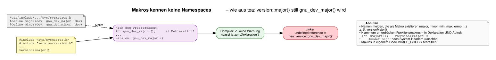

Die glibc definiert in `<sys/sysmacros.h>` die Makros `major(dev)` und `minor(dev)` für Gerätenummern. Bindet
irgendeine Datei diesen Header **vor** `version.h` ein, ersetzt der Präprozessor jeden Aufruf. Das passiert
**auch** innerhalb eines Namespace, denn Makros kennen keine Namespaces:

```text
exercise-003/main.cpp:59: undefined reference to `tea::version::gnu_dev_major()'
exercise-003/main.cpp:59: undefined reference to `tea::version::gnu_dev_minor()'
```

Besonders gemein: Der **Compiler** meldet nichts, denn auch die Deklaration in `version.h` wurde umbenannt, und
Aufruf und Deklaration passen zusammen. Erst der Linker stellt fest, dass es `gnu_dev_major()` nicht gibt.

Abhilfen:

* Namen vermeiden, die als Makro existieren (`major`, `minor`, `min`, `max`, `errno`, `assert` …), z. B.
  `versionMajor()`.
* Klammern verhindern die Expansion von Funktionsmakros, allerdings **in Deklaration und Aufruf**:
  `int (major)();` und `(version::major)()`. Nur den Aufruf zu klammern ergibt
  `no member named 'major' in namespace …` (getestet).
* Eigene Makros immer `GROSS_SCHREIBEN`, damit man sie als Makros erkennt.

Die Lösung behält die von der Aufgabe vorgegebenen Namen bei und dokumentiert die Falle in `version.h`.

### Stolperfalle 2: Zwei Konfig-Header mit gleichem Guard und Namespace

Vorher hatten `exercise-003/config.h.in` **und** `libs/version/version_config.h.in` beide den Guard `CONFIG_H_IN`
und legten Konstanten mit gleichen Namen (`PROJECT_NAME`, `PROJECT_VER_MAJOR` …) in `namespace tea` an. Solange jede
Datei nur einen der Header einbindet, fällt das nicht auf. Werden aber beide eingebunden, passiert Folgendes (mit den
Original-Headern getestet):

* Reihenfolge `config.h` → `version_config.h`: Der zweite Header wird übersprungen, und `tea::PROJECT_VER_MAJOR` ist
  der **String** `"0"` aus `config.h`:
  `error: cannot initialize return object of type 'int' with an lvalue of type 'const char *const'`.
* Umgekehrte Reihenfolge: **Kein Fehler**, aber `tea::PROJECT_NAME` ist plötzlich `"version_library"` statt
  `"exercise-003"`. Falsche Daten ohne jede Warnung sind der schlimmste Fall.

Das ist derselbe Copy-&-Paste-Fehler wie bei den Include Guards in Übung 002. Jetzt heißen die Guards
`TEA24_EXERCISE_003_CONFIG_H` bzw. `TEA24_VERSION_CONFIG_H`, und die Bibliothek nutzt den eigenen Namespace
`tea::version::config`.

### Weitere Korrekturen gegenüber der ersten Lösung

| Wo | Vorher | Jetzt |
| --- | --- | --- |
| `main.cpp` | `"The minor version from the lib: {}", patch()` | Copy-&-Paste-Fehler behoben |
| `version.cpp` | `fullVersion()` → `0.1.2` | `version_library-0.1.2` (Format laut README) |
| `version.h` | `#include <string>` vor dem Include Guard | innerhalb |
| `libs/version/CMakeLists.txt` | `include_directories()` (verzeichnisweit) **nach** `add_library` | `target_include_directories(… PRIVATE …)` |
| `libs/version/CMakeLists.txt` | `target_link_libraries(${PROJECT_NAME} …)` | expliziter Target-Name `version_library`. `${PROJECT_NAME}` war hier nur zufällig gleich dem Target |
| `exercise-003/CMakeLists.txt` | `find_package(Catch2)`, `find_package(nlohmann_json)`, Link gegen `CLI11` ohne Nutzung | nur noch, was das jeweilige Target wirklich braucht |
| Root-`CMakeLists.txt` | `add_subdirectory(libs)` nach den Übungen | davor |
