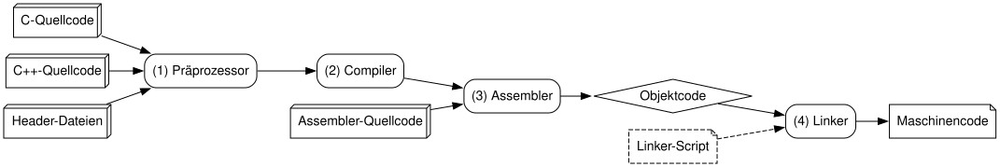
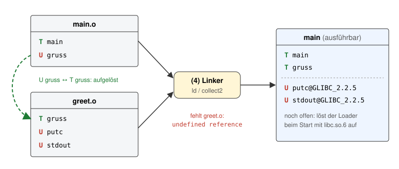
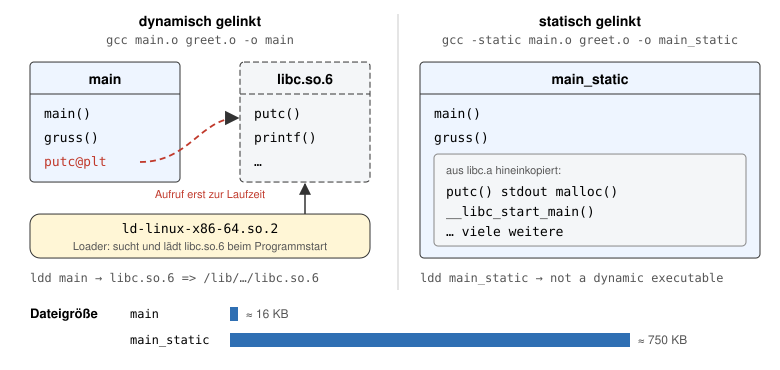
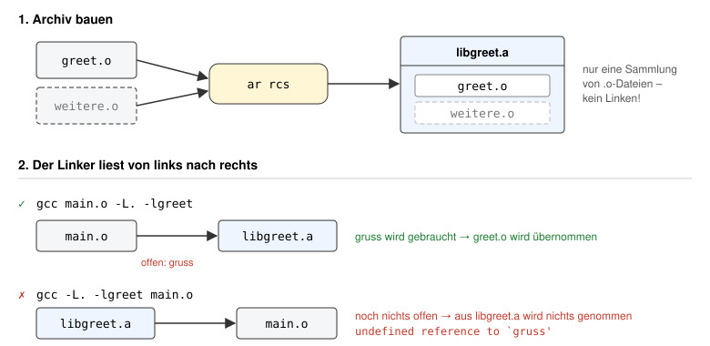

# Vom Quelltext zur ausführbaren Datei

## Überblick: Jede Stufe erzeugt eine andere Art von Datei



*Abbildung: Der Build-Prozess. Die Nummern (1) bis (4) stehen für die Stufen in der Tabelle und in Teil A.*

| Stufe | Befehl | Eingabe | Ausgabe | Typischer Fehler |
|---|---|---|---|---|
| (1) Präprozessor | `gcc -E` | `.c` | `.i` | Header nicht gefunden |
| (2) Compiler | `gcc -S` | `.i` | `.s` | Syntaxfehler, unbekannter Name |
| (3) Assembler | `gcc -c` | `.s` | `.o` | selten |
| (4) Linker | `gcc` | `.o` | ausführbare Datei | undefined reference, multiple definition |

Merksatz: Der Compiler kennt immer nur **eine** Datei. Der Linker füllt die Lücken zwischen den Dateien.

## Teil A: Eine Quelldatei, eine Header-Datei

Lege im Ordner  `exercise-004` zwei Dateien an.

**greet.h**

```c
#define ZEICHEN 'A'
```

**main.c**

```c
#include <stdio.h>
#include "greet.h"

int main(void)
{
    putc(ZEICHEN, stdout);
    putc('\n', stdout);
    return 0;
}
```

Führe die Schritte einzeln aus und trage ein, was du siehst. Die Schritte 1 bis 4 entsprechen den Stufen (1) bis (4) in der Abbildung.

| Schritt | Befehl | Was ich sehe |
|---|---|---|
| 1. Präprozessor | `gcc -E main.c -o main.i` |  |
| | `tail main.i` |  |
| 2. Compiler | `gcc -S main.i -o main.s` |  |
| | `cat main.s` |  |
| 3. Assembler | `gcc -c main.s -o main.o` |  |
| | `nm main.o` |  |
| | `objdump -dr main.o` |  |
| 4. Linker | `gcc main.o -o main` |  |
| | `./main` |  |
| | `objdump -d main` |  |

> **Tipp:** Die Zeilen der Form `# 6 "main.c" 3 4` in `main.i` sind Zeilenmarken für Fehlermeldungen. Mit `gcc -E -P main.c` werden sie weggelassen. `wc -l main.i` zeigt, wie viel `#include <stdio.h>` eigentlich einfügt.

Fragen zu Teil A:

1. Was ist aus `ZEICHEN` in `main.i` geworden? ______________________________________
2. Enthält `stdio.h` den Code von `putc` oder nur eine Deklaration? ______________________
3. Was bedeutet das `U` vor `putc` in der Ausgabe von `nm main.o`? ______________________
4. Was steht bei `call putc` in `main.o`, was in `main`? ______________________________


NOTE: Commit und push nicht vergessen!

## Teil B: Zwei Quelldateien und der Linker

Lege einen Ordner `exercise-004-01` an mit diesen drei Dateien.

**greet.h**

```c
void gruss(void);
```

**greet.c**

```c
#include <stdio.h>
#include "greet.h"

void gruss(void)
{
    putc('A', stdout);
    putc('\n', stdout);
}
```

**main.c**

```c
#include "greet.h"

int main(void)
{
    gruss();
    return 0;
}
```

| Schritt | Befehl | Was ich sehe |
|---|---|---|
| 1. Einzeln übersetzen | `gcc -c main.c -o main.o` |  |
| | `gcc -c greet.c -o greet.o` |  |
| 2. Symbole | `nm main.o` |  |
| | `nm greet.o` |  |
| 3. Fehler provozieren | `gcc main.o -o main` |  |
| 4. Richtig linken | `gcc main.o greet.o -o main` |  |
| | `./main` |  |



*Abbildung: `nm` zeigt mit `T` ein definiertes und mit `U` ein offenes (undefined) Symbol. Der Linker sucht für jedes `U` ein passendes `T`. Was er nicht findet, meldet er als* undefined reference*. Symbole aus der libc bleiben offen und werden erst beim Programmstart aufgelöst.*

Fragen zu Teil B:

1. Warum meldet der **Compiler** keinen Fehler, obwohl `gruss` in `main.c` nicht definiert ist? ______________________________________
2. Welche Stufe meldet *undefined reference*? ______________________
3. Was passiert, wenn du `gruss` zusätzlich in `main.c` definierst und beide Dateien linkst? Probiere es aus. ______________________

## Teil C: Dynamisch und statisch linken

Benutze die Dateien aus Teil B.

| Schritt | Befehl | Was ich sehe |
|---|---|---|
| 1. Dynamisch | `gcc main.o greet.o -o main` |  |
| | `ldd main` |  |
| | `file main` |  |
| 2. Statisch | `gcc -static main.o greet.o -o main_static` |  |
| | `ldd main_static` |  |
| | `file main_static` |  |
| 3. Größe | `ls -l main main_static` |  |
| 4. Symbol `putc` | `nm main \| grep putc` |  |
| | `nm main_static \| grep -w putc` |  |



*Abbildung: Beim dynamischen Linken steht in `main` nur ein Verweis auf `putc`; der Code liegt in `libc.so.6` und wird beim Start vom Loader nachgeladen. Beim statischen Linken kopiert der Linker die benötigten Teile aus `libc.a` direkt in die Datei.*

Fragen zu Teil C:

1. Warum ist `main_static` so viel größer als `main`? ______________________
2. Wo liegt der Code von `putc` bei `main`, wo bei `main_static`? ______________________
3. Was passiert, wenn die libc auf dem Zielsystem fehlt? Welche der beiden Dateien läuft trotzdem? ______________________

## Teil D (Bonus): Eine eigene statische Bibliothek von Hand

Benutze wieder die Dateien aus Teil B. Eine statische Bibliothek (`.a`) ist nichts anderes als ein Archiv von Objektdateien. Gebaut wird sie mit `ar`, nicht mit dem Linker.



| Schritt | Befehl | Was ich sehe |
|---|---|---|
| 1. Archiv bauen | `ar rcs libgreet.a greet.o` |  |
| | `ar t libgreet.a` |  |
| | `nm -A libgreet.a` |  |
| 2. Richtig linken | `gcc main.o -L. -lgreet -o main_lib` |  |
| | `./main_lib` |  |
| 3. Falsche Reihenfolge | `gcc -L. -lgreet main.o -o main_lib` |  |
| 4. Shared Library bauen | `gcc -fPIC -c greet.c -o greet_pic.o` |  |
| | `gcc -shared greet_pic.o -o libgreet.so` |  |
| 5. Nochmal linken | `gcc main.o -L. -lgreet -o main_so` |  |
| | `ldd main_so` |  |
| | `./main_so` |  |
| | `LD_LIBRARY_PATH=. ./main_so` |  |

Fragen zu Teil D:

1. Was bedeuten `-L.` und `-lgreet`? Welchen Dateinamen sucht der Linker bei `-lgreet`? ______________________
2. Warum schlägt Schritt 3 fehl, obwohl dieselben Dateien beteiligt sind? ______________________
3. In Schritt 5 liegen `libgreet.a` **und** `libgreet.so` im Ordner. Welche nimmt der Linker? Woran erkennst du das? ______________________
4. Warum findet `./main_so` die Bibliothek nicht, obwohl sie im selben Ordner liegt? ______________________

> **Tipp:** Mit `gcc ... -Wl,-rpath,'$ORIGIN'` wird ein Suchpfad in die Datei eingetragen. Prüfe das mit `readelf -d main_so | grep -E 'NEEDED|RUNPATH'`.

## Teil E (Bonus): Übungsaufgabe 3 komplett statisch

Voraussetzung: Übungsaufgabe 3 ist gelöst und `build/bin/exercise-003` lässt sich bauen.

### E.1 Wer ist hier eigentlich statisch?

| Schritt | Befehl | Was ich sehe |
|---|---|---|
| 1. Bibliothek | `ls -l build/lib` |  |
| | `ar t build/lib/libversion.a` |  |
| 2. Abhängigkeiten | `ldd build/bin/exercise-003` |  |
| 3. Symbole | `nm -C build/bin/exercise-003 \| grep -i version` |  |
| | `nm -C build/bin/exercise-003 \| grep 'fmt::' \| head` |  |

Fragen:

1. Taucht `libversion` in der Ausgabe von `ldd` auf? Warum (nicht)? ______________________
2. Welche Bibliotheken werden **noch** zur Laufzeit gebraucht? ______________________

### E.2 `{fmt}` statisch einbinden

Im Container ist `{fmt}` nur als Shared Library (`libfmt.so`) installiert, eine `libfmt.a` gibt es nicht. `{fmt}` bietet aber zusätzlich das CMake-Target `fmt::fmt-header-only` an: Dann wird der komplette `{fmt}`-Code beim Übersetzen in das eigene Programm eingebaut.

Lege in `exercise-003/CMakeLists.txt` ein zweites Executable an:

```cmake
add_executable(exercise-003-static main.cpp)
target_link_libraries(exercise-003-static PRIVATE version fmt::fmt-header-only)
```

> **Achtung:** Falls deine Bibliothek `version` selbst gegen `fmt::fmt` linkt (`PUBLIC`), musst du sie ebenfalls umstellen. `fmt::fmt` und `fmt::fmt-header-only` dürfen nicht im selben Programm gemischt werden.

| Schritt | Befehl | Was ich sehe |
|---|---|---|
| 1. Bauen | `cmake --build build` |  |
| 2. Vergleichen | `ldd build/bin/exercise-003-static` |  |
| | `ls -l build/bin/exercise-003 build/bin/exercise-003-static` |  |

### E.3 Alles statisch

Jetzt sollen auch `libstdc++` und `libc` hinein. Ergänze:

```cmake
add_executable(exercise-003-full-static main.cpp)
target_link_libraries(exercise-003-full-static PRIVATE version fmt::fmt-header-only)
target_link_options(exercise-003-full-static PRIVATE -static)
```

| Schritt | Befehl | Was ich sehe |
|---|---|---|
| 1. Bauen und starten | `./build/bin/exercise-003-full-static` |  |
| 2. Prüfen | `ldd build/bin/exercise-003-full-static` |  |
| | `file build/bin/exercise-003-full-static` |  |
| 3. Größen | `ls -lh build/bin/exercise-003*` |  |

Fragen zu Teil E:

1. Erstelle eine Tabelle: Programm, Größe, Bibliotheken laut `ldd`. ______________________
2. Was müsste passieren, damit eine Sicherheitslücke in `{fmt}` bzw. in der libc behoben wird, bei der dynamischen und bei der statischen Variante? ______________________
3. Warum ist auf einem Mikrocontroller (z. B. Raspberry Pi Pico) statisches Linken der Normalfall? ______________________

## Hinweise

- Für `-static` braucht man die statische libc (`libc.a`). Unter Debian und Ubuntu ist sie in `libc6-dev` enthalten, unter Fedora kommt sie mit `glibc-static`.
- Neuere `gcc`-Versionen bauen standardmäßig PIE-Binaries. Wenn die `objdump`-Ausgabe verwirrt, ergänze `-no-pie` beim Übersetzen und Linken.
- Mit `gcc -v` siehst du, welche Einzelprogramme `gcc` im Hintergrund aufruft.
- `file` ist im Container nicht vorinstalliert: `sudo apt-get update && sudo apt-get install -y file`
- `nm -C` übersetzt C++-Symbolnamen in lesbare Form (*demangling*). Alternativ: `nm main.o | c++filt`.
