# Lösung Übung 004: Vom Quelltext zur ausführbaren Datei

Alle Ausgaben in dieser Lösung stammen aus echten Läufen im Container (gcc 14.2, GNU ld 2.44, x86-64 Linux).
Adressen, die mit `0x55…` oder `0x7f…` beginnen, ändern sich bei jedem Start, siehe [PIE](#exkurs-pie-position-independent-executable).

## Inhalt

1. [Überblick](#überblick)
2. [Teil A: Eine Quelldatei, eine Header-Datei](#teil-a-eine-quelldatei-eine-header-datei)
3. [Exkurs: PIE (Position Independent Executable)](#exkurs-pie-position-independent-executable)
4. [Teil B: Zwei Quelldateien und der Linker](#teil-b-zwei-quelldateien-und-der-linker)
5. [Teil C: Dynamisch und statisch linken](#teil-c-dynamisch-und-statisch-linken)
6. [Teil D: Eine eigene statische Bibliothek von Hand](#teil-d-bonus-eine-eigene-statische-bibliothek-von-hand)
7. [Teil E: Übungsaufgabe 3 komplett statisch](#teil-e-bonus-übungsaufgabe-3-komplett-statisch)
8. [Abweichungen von der Aufgabenstellung](#abweichungen-von-der-aufgabenstellung)

---

## Überblick

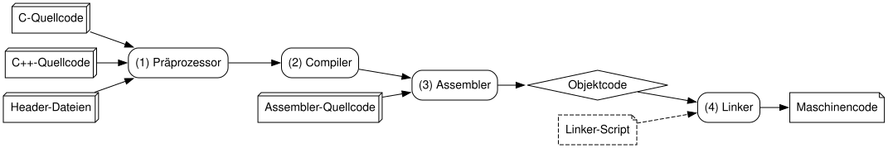

Teil A und Teil B liegen nacheinander im selben Ordner `exercise-004/`. Jeder Teil hat einen eigenen Commit:

| Commit | Stand | Ansehen |
| --- | --- | --- |
| `a66ce1b` „step #1“ | Teil A: `main.c` gibt `ZEICHEN` aus | `git show a66ce1b:exercise-004/main.c` |
| `1f5ea7b` „step #2“ | Teil B: `main.c` ruft `gruss()` aus `greet.c` | aktueller Stand von `main.c`, `greet.c`, `greet.h` |

Zwei kleine Abweichungen vom Aufgabentext:
- In Teil A steht zusätzlich `static int our_bss;` (siehe Frage A3).
- In Teil B kommt das Zeichen aus `#define ZEICHEN 'C'` in `greet.h`. Die Programme geben deshalb `C` statt `A` aus.

Teil E wird mit CMake gebaut (`main.cpp`, `CMakeLists.txt`). Alle Dateien, die die Befehle aus Teil A bis D
erzeugen, ignoriert git (`.gitignore`).

---

## Teil A: Eine Quelldatei, eine Header-Datei

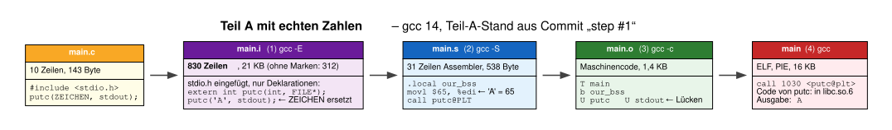

| Schritt | Befehl | Was ich sehe |
| --- | --- | --- |
| 1. Präprozessor | `gcc -E main.c -o main.i` | keine Ausgabe, aber `main.i` hat **830 Zeilen** (`main.c`: 10) |
| | `tail main.i` | das Ende von `main`, durchsetzt mit Zeilenmarken wie `# 7 "main.c" 3 4`. Statt `ZEICHEN` steht `'A'` |
| 2. Compiler | `gcc -S main.i -o main.s` | keine Ausgabe |
| | `cat main.s` | 31 Zeilen Assembler: `movl $65, %edi` (65 = `'A'`), `call putc@PLT`, `.local our_bss` |
| 3. Assembler | `gcc -c main.s -o main.o` | keine Ausgabe |
| | `nm main.o` | `T main`, `b our_bss`, `U putc`, `U stdout` |
| | `objdump -dr main.o` | `call` mit Ziel `00 00 00 00` und darunter `R_X86_64_PLT32 putc-0x4` |
| 4. Linker | `gcc main.o -o main` | keine Ausgabe |
| | `./main` | `A` |
| | `objdump -d main` | `call 1030 <putc@plt>`, dazu viel Code, der nicht von uns stammt (`_start`, `_init` …) |

Mit `gcc -E -P main.c` (ohne Zeilenmarken) ist das Ende von `main.i` gut lesbar:

```c
extern int __overflow (FILE *, int);

static int our_bss;
int main(void)
{
    putc('A', stdout);
    putc('\n', stdout);
    return 0;
}
```

### Fragen zu Teil A

**1. Was ist aus `ZEICHEN` in `main.i` geworden?**
Der Präprozessor hat es durch `'A'` ersetzt (`grep -c ZEICHEN main.i` ergibt 0). Makros gibt es nach dem
Präprozessor nicht mehr. Der Compiler sieht nur noch `putc('A', stdout);`, und im Assembler steht der Zahlenwert
`movl $65, %edi`.

**2. Enthält `stdio.h` den Code von `putc` oder nur eine Deklaration?**
Nur eine Deklaration:

```c
extern int putc (int __c, FILE *__stream) __attribute__ ((__nonnull__ (2)));
```

Die 820 zusätzlichen Zeilen in `main.i` sind fast nur Deklarationen, Typen und Makros. Der Code von `putc` liegt in
der libc (`libc.so.6`) und kommt erst beim Linken bzw. beim Programmstart dazu.

**3. Was bedeutet das `U` vor `putc` in der Ausgabe von `nm main.o`?**
**U**ndefined: `main.o` benutzt `putc`, enthält es aber nicht. Der Linker muss es woanders finden. Dasselbe gilt
für `stdout`: Auch die Variable kommt aus der libc. Die anderen Buchstaben kennen Sie aus Übung 002:

```text
0000000000000000 T main        T = Code (.text), global
0000000000000000 b our_bss     b = .bss, klein = lokal (static)
                 U putc        U = undefined, kommt von woanders
                 U stdout
```

**4. Was steht bei `call putc` in `main.o`, was in `main`?**

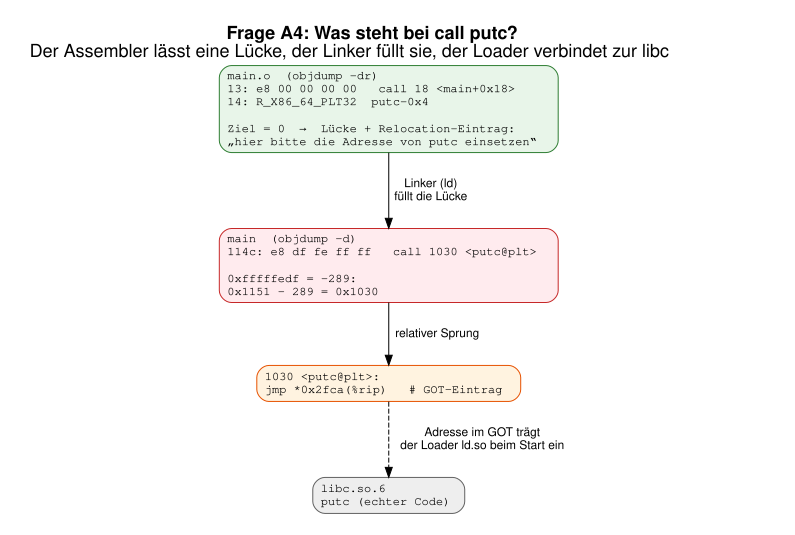

* In **`main.o`** steht `e8 00 00 00 00`, also ein Aufruf mit Ziel 0. Der Assembler kennt die Adresse von `putc`
  nicht und hinterlässt eine Lücke mit einem **Relocation-Eintrag** (`R_X86_64_PLT32 putc-0x4`): „Hier bitte später
  die Adresse von `putc` eintragen.“
* In **`main`** steht `e8 df fe ff ff   call 1030 <putc@plt>`. Der Linker hat die Lücke gefüllt, und zwar mit einem
  **relativen** Sprung: `0xfffffedf` = −289, und vom nächsten Befehl bei `0x1151` aus sind das genau `0x1030`.
* Bei `0x1030` steht aber nicht `putc` selbst, sondern ein kleiner Platzhalter in der **PLT** (Procedure Linkage
  Table). Er springt über einen Eintrag in der **GOT** (Global Offset Table). Diesen Eintrag füllt erst der Loader
  `ld.so` beim Programmstart mit der echten Adresse von `putc` in der `libc.so.6`.

---

## Exkurs: PIE (Position Independent Executable)

Die Aufgabe erwähnt in den Hinweisen `-no-pie`. Was steckt dahinter?

In Teil A beginnt `main` laut `objdump` bei `0x1139`. Das ist eine verdächtig kleine Zahl, denn kein Programm liegt
wirklich ab Adresse `0x1139` im Speicher. Der gcc im Container ist mit `--enable-default-pie` gebaut und erzeugt
standardmäßig **PIE**-Programme. Ein PIE kann an **jeder beliebigen Adresse** geladen werden, und Linux wählt diese
Adresse bei jedem Start **zufällig** (ASLR, *Address Space Layout Randomization*).

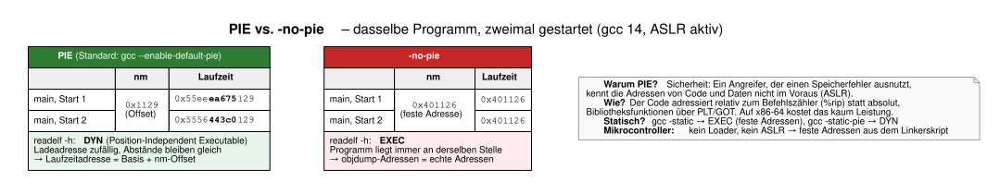

Ein kleines Programm, das die Adresse von `main` ausgibt, zweimal gestartet:

```text
gcc where.c -o pie                        gcc -no-pie where.c -o nopie
readelf -h: DYN (Position-Independent     readelf -h: EXEC (Executable file)
             Executable file)
nm:      0000000000001129 T main          nm:      0000000000401126 T main
Start 1: main @ 0x55eeea675129            Start 1: main @ 0x401126
Start 2: main @ 0x5556443c0129            Start 2: main @ 0x401126
```

* **PIE**: `nm` und `objdump` zeigen nur **Offsets** relativ zum Programmanfang. Die echte Adresse ist
  *zufällige Basis + Offset*. Die letzten Stellen (`…129`) bleiben gleich, der Rest ändert sich bei jedem Start.
  Dasselbe haben Sie in Übung 002 bei den Speichersegmenten gesehen.
* **`-no-pie`**: Das Programm liegt immer an derselben Stelle. Die Adressen in `objdump` sind die echten Adressen.
  Für Teil A ergibt das `401126 <main>` und `call 401030 <putc@plt>`.

**Warum PIE?** Sicherheit. Viele Angriffe auf Speicherfehler (Pufferüberlauf) springen gezielt zu bekanntem Code
im Programm. Liegt das Programm bei jedem Start woanders, kennt der Angreifer diese Adressen nicht. Deshalb sind PIE
und ASLR heute bei allen gängigen Linux-Distributionen Standard. (`cat /proc/sys/kernel/randomize_va_space` ergibt
im Container `2`, also volle Zufallsverteilung.)

**Wie funktioniert das?** Der Code darf keine festen Adressen enthalten. Auf x86-64 adressiert er deshalb relativ
zum Befehlszähler, z. B. `mov 0x2ed4(%rip),%rax` für `stdout`. Funktionen aus Bibliotheken ruft er über PLT/GOT auf
(Frage A4). Auf x86-64 kostet das kaum Leistung, weil der Prozessor relative Adressierung direkt unterstützt.

**PIE, PIC und `-fPIC` aus Teil D:**

| Option | Bedeutung | Wofür |
| --- | --- | --- |
| `-fPIE` (gcc-Standard hier) | positionsunabhängiger Code für ein **Programm** | normale Programme |
| `-fPIC` | positionsunabhängiger Code für eine **Bibliothek** | Shared Libraries (`.so`) |
| `-no-pie` / `-fno-pie` | Programm mit festen Adressen | Debugging, Lehre, sehr alte Systeme |

Der Unterschied zwischen `-fPIE` und `-fPIC` zeigt sich in Teil D bei `greet.c`. Ein Programm weiß, dass `stdout`
später in ihm selbst landet, und greift direkt darauf zu. Eine Bibliothek kann das nicht wissen und geht über die GOT:

```text
gcc -c greet.c        (-fPIE):   R_X86_64_PC32          stdout-0x4   direkt, relativ
gcc -fPIC -c greet.c         :   R_X86_64_REX_GOTPCRELX stdout-0x4   über die GOT
```

**Und statisch?** `gcc -static` erzeugt ein Programm mit festen Adressen (`EXEC`, siehe Teil C). Mit
`gcc -static-pie` geht auch beides zusammen (`DYN`). **Auf einem Mikrocontroller** gibt es weder Loader noch ASLR:
Das Linkerskript legt fest, wo Code (Flash) und Daten (RAM) liegen, und das Programm läuft genau dort.

---

## Teil B: Zwei Quelldateien und der Linker

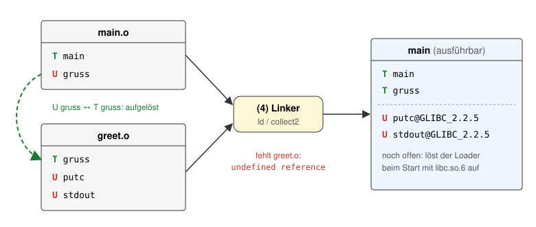

| Schritt | Befehl | Was ich sehe |
| --- | --- | --- |
| 1. Einzeln übersetzen | `gcc -c main.c -o main.o` | keine Ausgabe |
| | `gcc -c greet.c -o greet.o` | keine Ausgabe |
| 2. Symbole | `nm main.o` | `U gruss`, `T main` |
| | `nm greet.o` | `T gruss`, `U putc`, `U stdout` |
| 3. Fehler provozieren | `gcc main.o -o main` | ``main.c:(.text+0x5): undefined reference to `gruss'`` |
| 4. Richtig linken | `gcc main.o greet.o -o main` | keine Ausgabe |
| | `./main` | `C` |

### Fragen zu Teil B

**1. Warum meldet der Compiler keinen Fehler, obwohl `gruss` in `main.c` nicht definiert ist?**
Weil `greet.h` die **Deklaration** `void gruss(void);` liefert. Damit weiß der Compiler alles, was er für den Aufruf
braucht (Name, Parameter, Rückgabetyp). Wo der Code liegt, ist für ihn egal, denn er kennt immer nur **eine** Datei.
Er trägt `gruss` als `U` in `main.o` ein.

**2. Welche Stufe meldet *undefined reference*?**
Der **Linker** (`/usr/bin/ld`, aufgerufen über `collect2`). Erst er sieht alle Objektdateien zusammen und merkt, dass
niemand `gruss` definiert.

**3. Was passiert, wenn du `gruss` zusätzlich in `main.c` definierst?**

```text
/usr/bin/ld: greet.o: in function `gruss':
greet.c:(.text+0x0): multiple definition of `gruss'; main.o:main.c:(.text+0x0): first defined here
```

Jetzt gibt es zwei `T gruss`, und der Linker weiß nicht, welches gemeint ist. Jedes Symbol darf im ganzen Programm
nur **einmal** definiert sein. Ausnahme: `static` (interne Bindung, Übung 002), dann sieht der Linker es gar nicht.

---

## Teil C: Dynamisch und statisch linken

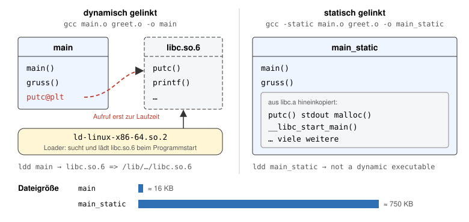

| Schritt | Befehl | Was ich sehe |
| --- | --- | --- |
| 1. Dynamisch | `gcc main.o greet.o -o main` | keine Ausgabe |
| | `ldd main` | `linux-vdso.so.1`, `libc.so.6 => /lib/x86_64-linux-gnu/libc.so.6`, `/lib64/ld-linux-x86-64.so.2` |
| | `file main` | `file` ist nicht installiert, siehe unten. Ersatz: `readelf -h main` → `DYN (Position-Independent Executable file)` |
| 2. Statisch | `gcc -static main.o greet.o -o main_static` | keine Ausgabe |
| | `ldd main_static` | `not a dynamic executable` |
| | `file main_static` | Ersatz: `readelf -h main_static` → `EXEC (Executable file)`, kein Program Interpreter |
| 3. Größe | `ls -l main main_static` | `16056 main`, `754416 main_static` |
| 4. Symbol `putc` | `nm main \| grep putc` | `U putc@GLIBC_2.2.5` |
| | `nm main_static \| grep -w putc` | `00000000004047e0 W putc` |

`file` lässt sich mit `sudo apt-get update && sudo apt-get install -y file` nachinstallieren. Es zeigt dann im
Wesentlichen dieselben Informationen wie `readelf -h` und `readelf -l` (Typ, dynamisch gelinkt, Interpreter).

### Fragen zu Teil C

**1. Warum ist `main_static` so viel größer als `main`?**
Mit 754 KB statt 16 KB ist es etwa 47-mal so groß. Der Linker hat alles aus `libc.a` hineinkopiert, was `putc`
(direkt oder indirekt) braucht: Pufferverwaltung für `stdout`, Locale-Unterstützung, Programmstart und -ende usw.
`nm main_static | wc -l` zählt 1940 Symbole, bei `main` sind es 32.

**2. Wo liegt der Code von `putc` bei `main`, wo bei `main_static`?**
* `main`: in `/lib/x86_64-linux-gnu/libc.so.6`. Im Programm steht nur `U putc@GLIBC_2.2.5`, ein offener Verweis
  samt Versionsangabe. Der Loader verbindet ihn beim Start.
* `main_static`: im Programm selbst, an der festen Adresse `0x4047e0`. Das `W` (weak) kommt daher, dass `putc` in
  der glibc ein Alias für eine interne Funktion ist.

**3. Was passiert, wenn die libc auf dem Zielsystem fehlt?**
`main` startet nicht. Schon der Loader `/lib64/ld-linux-x86-64.so.2` gehört zur libc und fehlt dann. `main_static`
läuft trotzdem, weil es nichts von außen braucht (`not a dynamic executable`). Deshalb verteilt man kleine
Werkzeuge gern statisch gelinkt, z. B. für Rettungssysteme oder minimale Container.

---

## Teil D (Bonus): Eine eigene statische Bibliothek von Hand

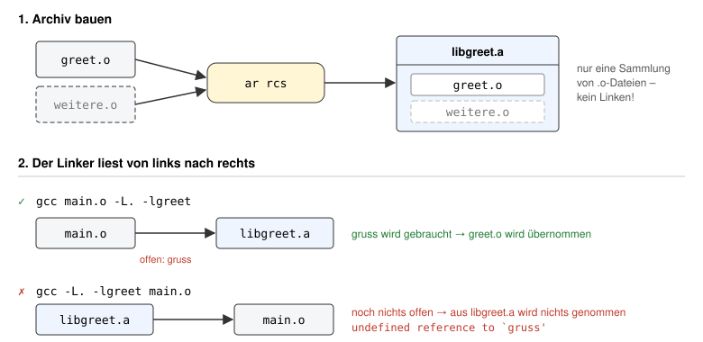

| Schritt | Befehl | Was ich sehe |
| --- | --- | --- |
| 1. Archiv bauen | `ar rcs libgreet.a greet.o` | keine Ausgabe |
| | `ar t libgreet.a` | `greet.o` |
| | `nm -A libgreet.a` | `libgreet.a:greet.o:… T gruss`, `… U putc`, `… U stdout` |
| 2. Richtig linken | `gcc main.o -L. -lgreet -o main_lib` | keine Ausgabe |
| | `./main_lib` | `C` |
| 3. Falsche Reihenfolge | `gcc -L. -lgreet main.o -o main_lib` | ``undefined reference to `gruss'`` |
| 4. Shared Library bauen | `gcc -fPIC -c greet.c -o greet_pic.o` | keine Ausgabe |
| | `gcc -shared greet_pic.o -o libgreet.so` | keine Ausgabe |
| 5. Nochmal linken | `gcc main.o -L. -lgreet -o main_so` | keine Ausgabe |
| | `ldd main_so` | `libgreet.so => not found` |
| | `./main_so` | `error while loading shared libraries: libgreet.so: cannot open shared object file: No such file or directory` |
| | `LD_LIBRARY_PATH=. ./main_so` | `C` |

### Fragen zu Teil D

**1. Was bedeuten `-L.` und `-lgreet`?**
`-L.` fügt das aktuelle Verzeichnis (`.`) zu den Orten hinzu, an denen der Linker nach Bibliotheken sucht.
`-lgreet` heißt „linke die Bibliothek *greet*“. Der Linker setzt den Dateinamen selbst zusammen: **`libgreet.so`**,
und wenn es die nicht gibt, **`libgreet.a`**. Präfix `lib` und Endung lässt man weg.

**2. Warum schlägt Schritt 3 fehl, obwohl dieselben Dateien beteiligt sind?**

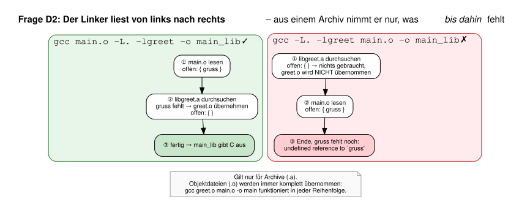

Der Linker arbeitet die Kommandozeile **von links nach rechts** ab. Aus einem Archiv übernimmt er nur Objektdateien,
die ein **bis dahin** offenes Symbol liefern. Steht `-lgreet` vorne, fehlt noch nichts, also nimmt er nichts. Danach
kommt `main.o` und verlangt `gruss`, aber das Archiv ist schon abgearbeitet. Regel: **Bibliotheken nach den Dateien,
die sie benutzen.** Für `.o`-Dateien gilt das nicht, die werden immer komplett übernommen
(`gcc greet.o main.o` funktioniert auch).

**3. `libgreet.a` und `libgreet.so` liegen beide im Ordner. Welche nimmt der Linker?**
Die **`.so`**. Bei `-lgreet` bevorzugt der GNU-Linker die Shared Library. Woran man das erkennt:
* `ldd main_so` listet `libgreet.so` (bei `main_lib` taucht keine `libgreet` auf).
* `readelf -d main_so | grep NEEDED` zeigt `Shared library: [libgreet.so]`.
* `./main_so` startet ohne `LD_LIBRARY_PATH` nicht. Mit der `.a` würde es laufen.

Wer trotzdem die statische möchte, schreibt `-l:libgreet.a` (genauer Dateiname) oder linkt mit `-static`.

**4. Warum findet `./main_so` die Bibliothek nicht, obwohl sie im selben Ordner liegt?**

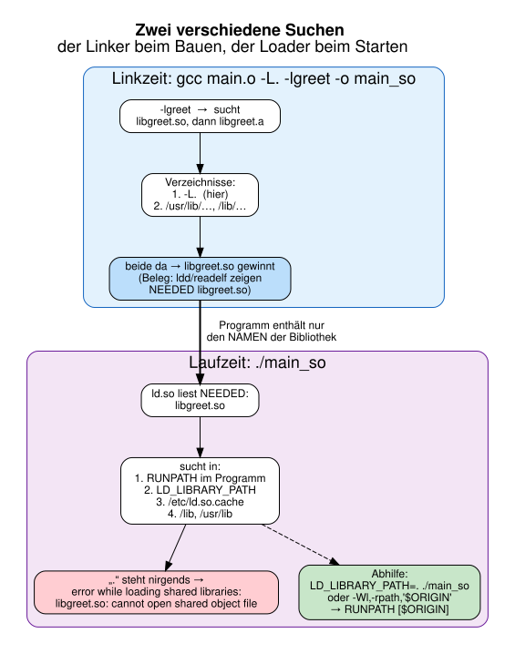

Linker und Loader suchen **unabhängig voneinander**. `-L.` hat nur dem **Linker** beim Bauen geholfen. Im Programm
steht danach nur der *Name* `libgreet.so`, kein Pfad. Beim Start sucht der **Loader** `ld.so` an festen Orten:
`RUNPATH` im Programm, `LD_LIBRARY_PATH`, `/etc/ld.so.cache`, `/lib` und `/usr/lib`. Das aktuelle Verzeichnis gehört
absichtlich nicht dazu, sonst könnte jede Datei im aktuellen Ordner eine Systembibliothek ersetzen.

Der Tipp aus der Aufgabe trägt einen Suchpfad ins Programm ein. `$ORIGIN` steht für „das Verzeichnis, in dem das
Programm liegt“:

```text
$ gcc main.o -L. -lgreet -Wl,-rpath,'$ORIGIN' -o main_so
$ readelf -d main_so | grep -E 'NEEDED|RUNPATH'
 0x0000000000000001 (NEEDED)             Shared library: [libgreet.so]
 0x0000000000000001 (NEEDED)             Shared library: [libc.so.6]
 0x000000000000001d (RUNPATH)            Library runpath: [$ORIGIN]
$ ./main_so
C
```

Genau das macht CMake automatisch für Programme im Build-Ordner (Übung 003, `RUNPATH /workspaces/tea24/build/lib`).

---

## Teil E (Bonus): Übungsaufgabe 3 komplett statisch

Gebaut wird mit `cmake --build build`. [CMakeLists.txt](CMakeLists.txt) enthält drei Programme aus derselben
[main.cpp](main.cpp):

```text
Project: version_library
Version: 0.1.2
Full:    version_library-0.1.2
```

### E.1 Wer ist hier eigentlich statisch?

| Schritt | Befehl | Was ich sehe |
| --- | --- | --- |
| 1. Bibliothek | `ls -l build/lib` | `libversion_library.a` (130 KB) und die Shared-Variante aus Übung 003 |
| | `ar t build/lib/libversion_library.a` | `version.cpp.o`, `version_c_api.cpp.o` |
| 2. Abhängigkeiten | `ldd build/bin/exercise-004` | `libfmt.so.12`, `libstdc++.so.6`, `libm.so.6`, `libgcc_s.so.1`, `libc.so.6` |
| 3. Symbole | `nm -C build/bin/exercise-004 \| grep -i version` | `T tea::version::fullVersion[abi:cxx11]()`, `T tea::version::major()` … |
| | `nm -C build/bin/exercise-004 \| grep 'fmt::' \| head` | `W fmt::v12::println<…>` usw. |

**1. Taucht `libversion` in der Ausgabe von `ldd` auf?** Nein. Sie ist statisch gelinkt, ihr Code wurde beim Linken
ins Programm kopiert. `nm` findet `tea::version::…` deshalb mit `T` direkt im Programm. `ldd` listet nur, was beim
Start **nachgeladen** wird.

**2. Welche Bibliotheken werden noch zur Laufzeit gebraucht?**
`libfmt.so.12` ({fmt}), `libstdc++.so.6` (C++-Standardbibliothek, z. B. `std::string`), `libm.so.6` (Mathematik),
`libgcc_s.so.1` (Hilfsfunktionen des Compilers, z. B. für Exceptions) und `libc.so.6`. Die `fmt::`-Symbole im
Programm sind nur Template-Instanzen aus den Headern (`W`). Die eigentliche Formatierung (`vformat`) liegt in
`libfmt.so`.

### E.2 `{fmt}` statisch einbinden

Wörtlich nach Aufgabe, also nur das Programm auf `fmt::fmt-header-only` umgestellt, läuft das Programm. **`ldd`
zeigt aber weiterhin `libfmt.so.12`.**

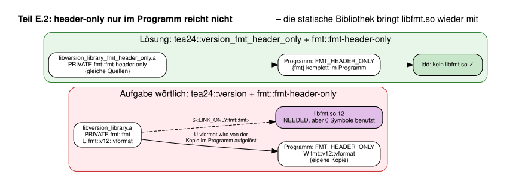

Die Ursache: Die Versionsbibliothek linkt `fmt::fmt` zwar `PRIVATE`. Eine **statische** Bibliothek ist aber nur ein
Archiv mit offenen Symbolen (`U fmt::v12::vformat`), deshalb reicht CMake die Abhängigkeit als
`$<LINK_ONLY:fmt::fmt>` an jedes Programm weiter (Übung 003, Fazit 3). Das Ergebnis ist doppelt unschön:

* `libfmt.so.12` steht als `NEEDED` im Programm, aber kein einziges Symbol daraus wird benutzt
  (`nm -D --undefined-only … | grep -c fmt` ergibt 0).
* Das offene `vformat` der Bibliothek wird von der header-only-Kopie im Programm aufgelöst. Zwei verschieden
  übersetzte {fmt}-Varianten stecken im selben Programm. Das geht hier nur zufällig gut.

Die Lösung ist eine eigene Variante der Bibliothek, die gegen header-only {fmt} übersetzt wird
([libs/version/CMakeLists.txt](../libs/version/CMakeLists.txt)):

```cmake
add_library(version_library_fmt_header_only STATIC ${VERSION_LIBRARY_SOURCES})
add_library(tea24::version_fmt_header_only ALIAS version_library_fmt_header_only)
target_link_libraries(version_library_fmt_header_only PRIVATE fmt::fmt-header-only)
```

```cmake
add_executable(exercise-004-static main.cpp)
target_link_libraries(exercise-004-static PRIVATE tea24::version_fmt_header_only fmt::fmt-header-only)
```

| Schritt | Befehl | Was ich sehe |
| --- | --- | --- |
| 1. Bauen | `cmake --build build` | baut `libversion_library_fmt_header_only.a` und `exercise-004-static` |
| 2. Vergleichen | `ldd build/bin/exercise-004-static` | `libstdc++.so.6`, `libm.so.6`, `libgcc_s.so.1`, `libc.so.6`, **kein libfmt** |
| | `ls -l build/bin/exercise-004 build/bin/exercise-004-static` | 105 KB → 881 KB |

### E.3 Alles statisch

```cmake
add_executable(exercise-004-full-static main.cpp)
target_link_libraries(exercise-004-full-static PRIVATE tea24::version_fmt_header_only fmt::fmt-header-only)
target_link_options(exercise-004-full-static PRIVATE -static)
```

| Schritt | Befehl | Was ich sehe |
| --- | --- | --- |
| 1. Bauen und starten | `./build/bin/exercise-004-full-static` | dieselbe Ausgabe wie oben |
| 2. Prüfen | `ldd build/bin/exercise-004-full-static` | `not a dynamic executable` |
| | `file build/bin/exercise-004-full-static` | Ersatz `readelf -h`: `EXEC (Executable file)`, kein Program Interpreter |
| 3. Größen | `ls -lh build/bin/exercise-004*` | 103 K, 860 K, 2,8 M |

### Fragen zu Teil E

**1. Tabelle: Programm, Größe, Bibliotheken laut `ldd`**

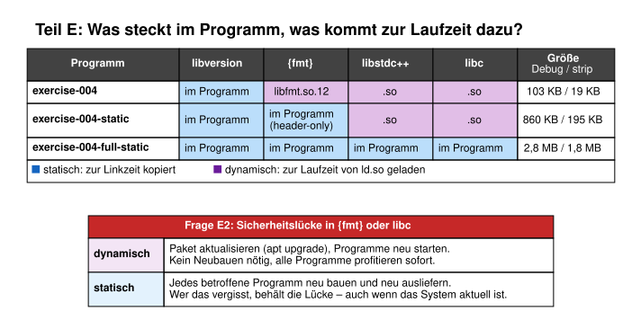

| Programm | Größe (Debug) | nach `strip` | Typ | Bibliotheken laut `ldd` |
| --- | --- | --- | --- | --- |
| `exercise-004` | 103 KB | 19 KB | PIE | libfmt, libstdc++, libm, libgcc_s, libc |
| `exercise-004-static` | 860 KB | 195 KB | PIE | libstdc++, libm, libgcc_s, libc |
| `exercise-004-full-static` | 2,8 MB | 1,8 MB | EXEC | keine |

Die Debug-Größen enthalten viele Debug-Informationen. Nach `strip` sieht man, was wirklich an Code dazukommt: rund
175 KB für {fmt} und gut 1,6 MB für libstdc++ und libc.

**2. Was müsste bei einer Sicherheitslücke in {fmt} bzw. in der libc passieren?**
* **Dynamisch**: Das Systempaket wird aktualisiert (`apt upgrade`), danach die Programme neu gestartet. Kein Programm
  muss neu gebaut werden, alle profitieren sofort.
* **Statisch**: Jedes betroffene Programm muss mit der korrigierten Bibliothek **neu gebaut und neu ausgeliefert**
  werden. Wer eines vergisst, behält die Lücke, auch wenn das System selbst aktuell ist. Man muss also wissen,
  welche Programme welche Bibliotheksversion enthalten.

**3. Warum ist auf einem Mikrocontroller statisches Linken der Normalfall?**
* Es gibt kein Betriebssystem mit Loader (`ld.so`) und kein Dateisystem, aus dem man `.so`-Dateien nachladen könnte.
* Das Programm wird als **ein** Abbild in den Flash geschrieben und läuft an festen Adressen (kein PIE, kein ASLR).
* Der Linker übernimmt nur benötigte Objektdateien. Das spart Flash, und mit `-ffunction-sections -Wl,--gc-sections`
  lässt sich noch mehr sparen.
* Speicherbedarf und Adressen stehen zur Linkzeit fest. Das ist wichtig für Memory Map, Timing und Zertifizierung.
* Updates betreffen ohnehin immer die ganze Firmware, der Vorteil dynamischer Bibliotheken entfällt also.

---

## Abweichungen von der Aufgabenstellung

| Stelle | Aufgabe | Tatsächlich |
| --- | --- | --- |
| Teil D, Kasten zu `ar` | Ohne `s` meldet der Linker *archive has no index* | GNU `ar` schreibt den Index **immer**, auch bei `ar rc`. Die Meldung erscheint nur mit `ar rcS` (großes `S` = keinen Index schreiben). |
| Teil E.1 | `build/lib/libversion.a`, Target `version` | `build/lib/libversion_library.a`, Target `tea24::version` (Namen aus Übung 003) |
| Teil E.2, Achtung-Kasten | Nur bei `PUBLIC fmt::fmt` muss die Bibliothek umgestellt werden | Auch bei `PRIVATE`, weil eine statische Bibliothek ihre Link-Abhängigkeiten immer weitergibt (siehe E.2) |
| Teil C, E | `file …` | `file` ist im Container nicht installiert, `readelf -h` / `readelf -l` liefern dieselbe Information |
| git-Befehle oben | Kommentar „based on exercise-003“ | gemeint ist exercise-004 |

---

Die Grafiken in [doc/](doc/) lassen sich neu erzeugen:

```sh
cmake --build build --target exercise-004-diagrams
```
